# Arne's function, in any language — PEN&PAD on the Arne scenario
Nordic Hackathon 2026, PEN&PAD-26 bonus track · Nimloth

One coded record of Arne's functional status — entered by the clinician or by Arne himself, sanctioned by SNOMED CT, stored in openEHR, sent as an EPS document — and read by every receiver in their own language.

**Live demo:** https://penpad.nimloth.se (clinician mode) · https://penpad.nimloth.se/patient/ (patient mode). Open during the hackathon, rate-limited.
**Contact:** Anders Carlius, Northfactor AB — [e-post fylls i av Anders]

## The gap we aimed at
Arne (83, fictional) breaks his hip on the stairs in Copenhagen and is discharged from a Danish hospital to home care in Sweden. The organisers' medical comments name three gaps: **functional status is missing and nobody notices**, **his son ends up as the interpreter**, and **nobody confirms the hand-over**.

We used the same coded record for both sides of the border:
- **Clinician mode** (discharge, Rigshospitalet) follows the track's three steps. *Orientation:* 2D body map (hip, leg, chest), topic list (transfer, walking, stairs, breathing, pain, wound), or free text / speech. *Refinement:* only follow-ups that make sense, as short questions (fracture → left or right? operated? · walking → aid? how far? · breathing → breathless at rest, walking or stairs?). *Confirmation:* "Is this what you meant?" as a live sentence.
- **Patient mode** (at home in Sweden): plain Swedish, big buttons and a **3D body** to point at (where it hurts, where the leg ulcer is), with the same choices as a list next to it. Arne answers himself, or his son does it for him. The result is saved as a **draft marked patient-reported**, with "reported by: patient / relative". The home-care nurse opens the draft in clinician mode, refines it and confirms it. We show provenance; we do not try to solve proxy consent.
- **Interface language:** both modes have an **SV | EN** switch in the header. The interface is in Swedish and English; the English interface text (including clinical labels) is `draft_unreviewed`. This is separate from the record's language: switching re-labels the page only, sends nothing and leaves the coded record unchanged (QA assertion 12).

## Design choice: 3D only by default for the patient
3D is the default only in patient mode. For clinicians, a list/2D map is faster — 'exhaustive is the enemy of the useful' (Rector, Part 2). We'd like to test this with the actor test.

Clinicians can switch on the same 3D view ("Visa i 3D"; the choice is remembered in the browser). Both modes use the same component, geometry, FMA→SNOMED table and refinement engine. The body turns slowly (one revolution per ~60 s), stops while the user points at or drags it, and does not move at all under `prefers-reduced-motion`. If WebGL or the geometry is missing, the list/2D map takes over.

## Three things worth looking at
1. **The track's three steps in both modes**: orientation, refinement and confirmation.
2. **The sentence generator removes the need for an interpreting son.** One coded entry is rendered deterministically in **Swedish, Norwegian (bokmål), Danish, Finnish, German and English**, plus plain Swedish for Arne. The templates are hand-written and visible (`generator/templates/{sv,sv-enkel,nb,da,fi,de,en}.yaml`). No LLM generates text. A concept without a template is shown as SNOMED term + code + "no translation"; it never fails silently.
   - sv: *Opererad fraktur på vänster lårbenshals. Går med rollator inomhus cirka 10 meter. Klarar inte trappor. Andfådd vid gång.*
   - da: *Opereret fraktur af venstre lårbenshals. Går med rollator indendørs ca. 10 meter. Kan ikke gå på trapper. Åndenød ved gang.*
3. **Functional status lands in an EPS document, with the validation result.** The findings become `Condition`s in the EPS section *Functional status* (LOINC 47420-5), added to a copy of the hackathon's Arne EPS bundle; the original is never overwritten.
   - Published: [`Bundle/24787`](https://fhir.nimloth.se/fhir/Bundle/24787) (identifier `nimloth-eps-arne-penpad`, 9 sections; the Composition narrative is generated from `Composition.section`, so no section can be missing from it).
   - Validation against `bundle-eu-eps` 1.0.0-ballot with the Swedish base IG (matchbox): **0 errors**, 127 warnings (the original fixture: 0 errors, 118 warnings; the extra warnings are an eHDSI value set the validator cannot resolve). `$validate` on fhir.nimloth.se, which has neither the EPS nor the Swedish base IG loaded, reports 4 errors — the same 4 "profile not found" errors (SEBasePatient, SEBaseOrganization, SEBasePractitioner, SEBasePractitionerRole) that the unchanged original gets there.
   - A **receipt button** ("Mottaget och läst") writes a FHIR `Task` with status *completed*: [`Task/24788`](https://fhir.nimloth.se/fhir/Task/24788), focus `Bundle/24787`. A sent document is not a confirmed hand-over.
   - Earlier versions: [`Bundle/24785`](https://fhir.nimloth.se/fhir/Bundle/24785), [`Task/24786`](https://fhir.nimloth.se/fhir/Task/24786) (narrative without the new section); `Bundle/24789` is an accidental empty test post — ignore it.

## Finding: the gap is also in the standard
EPS 1.0.0-ballot lets the *Functional status* section reference only `Condition`, `ClinicalImpression` and `DocumentReference` (`Composition.section:sectionFunctionalStatus.entry`, targetProfile; named slices `disability` → condition-eu-core and `functionalAssessment` → ClinicalImpression). An `Observation` — for example a scored assessment such as Barthel, or "walks 10 m with a rollator" as a measurement — cannot be placed there. We therefore sent Arne's functional status as Conditions. Exact excerpt and source: [eps-functional-status-finding.md](eps-functional-status-finding.md).

## Alan's layers, in this build
Mapped onto the six dimensions in Alan Rector's draft *PEN&PAD, GALEN & GRAIL: Thoughts on lessons learned* (Nov 2026, §2, pp. 1–3; cited as a draft).

| Layer (Rector, Principle 2) | PEN&PAD-26 | Where |
|---|---|---|
| Meaning / knowledge | SNOMED CT, Swedish edition in Snowstorm: ECL membership and MRCM attribute ranges sanction every coded option at runtime | `model/arne-scenario.json` (candidates), `server.mjs` `/api/sct/*`, `public/arne-engine.js` `init()` |
| Higher order knowledge | Not implemented | — |
| Editorial information | Template `review_status` (all `draft_unreviewed`), the hand-written FMA→SNOMED table with its provenance notes, the SNOMED code audit and the QA report. A comparison with Clinergy is not done | `generator/templates/*.yaml`, `mapping/fma-to-snomed-arne.yaml`, `docs/snomed-code-audit.md`, `qa-rector-report.md` |
| Linguistic knowledge | Deterministic templates in seven language variants (sv, nb, da, fi, de, en, sv-enkel) | `generator/templates/*.yaml` |
| Interworking | FHIR R4 / EPS mapping (Conditions in section 47420-5) and FMA→SNOMED for the 3D body. A FHIR→openEHR import is not part of this build | `public/arne-engine.js` (`condition`, `epsBundle`), `mapping/fma-to-snomed-arne.yaml` |
| Data | openEHR compositions in EHRbase (template `nimloth_penpad26_symptom.v0`), one fictional demo EHR; FHIR resources only as the exchange copy | `opt/build_opt.py`, `public/openehr.js` |

## Nearest pre-coordinated concept (an ECL search, not classification)
For a post-coordinated entry (e.g. pain + finding site + laterality), the clinician view shows the most general existing SNOMED CT concepts that match, found with ECL `(E) MINUS (< (E))`, where E is `<< focus : attribute = << value`. Example: right leg ulcer → *Chronic ulcer of right lower leg*; left hip pain → *Pain of left hip joint*; with a severity added → "inget hittat". This is an ECL search over existing concepts. It is **not** DL classification: unlike GALEN (draft p. 4, "a new temporary class was created, classified using a DL query"), we create no class and run no classifier at runtime.

## Send codes, render locally
Sending and viewing are two different things. What goes to Swedish home care is the **coded record** (openEHR composition, FHIR resources, the receipt) plus one narrative in the **receiver's** language, Swedish. The receiver decides the language; nobody picks it from a menu. The drop-down **"Visa som mottagaren ser det"** only shows the same coded record rendered in another language, so a Danish, Norwegian, Finnish or German reader sees what *they* would read. Switching it sends nothing and changes nothing (tested: `test/i18n.mjs`). Nobody translates the message; each receiver reads the codes in their own language.

Finnish needs case endings that depend on the body part ("vasemmassa lonkassa", "vasemman reisiluun"), so the Finnish fracture, pain and wound templates are whole sentences per side instead of slots. German avoids the problem by putting the side last, as clinical shorthand does ("Schenkelhalsfraktur links"). All 158 answer combinations of the scenario have a template in every language; a missing one would show SNOMED term + code + "no translation", never silently.

**Native speakers of Norwegian, Danish, Finnish or German: corrections to `generator/templates/` are very welcome as pull requests.**

## Notes on Alan's draft, from building this
- **Pragmatic layer (p. 5).** The draft asks whether the linguistic layer should "be broadened to the pragmatic layer". Here the same coded entry is rendered for different readers: a Danish or Swedish clinician, and Arne in plain Swedish. A small, concrete case of a linguistic layer that has turned pragmatic.
- **Sanctions (pp. 1, 4).** GRAIL's goal of allowing all and only what is sensible to say (p. 1) maps well onto SNOMED CT's MRCM: it was enough to drop laterality where the domain does not allow it and to keep severity values inside their range (QA assertion 7). It was not enough on its own for the side of a fracture (we use lateralised pre-coordinated concepts) or for anything uncoded such as walking distance, which lives only in the archetype.
- **Automatic QA (p. 3).** In the spirit of GALEN's final-step queries of what should and should not be true (p. 3), thirteen assertions (eight should, five should-not, with deliberately wrong options and an injected hardcoded string as negative controls) run before every push and deploy: [rector-assertions.test.ts](rector-assertions.test.ts), latest result [qa-rector-report.md](qa-rector-report.md).

## Rector's recipe, applied
| Rector (interviews part 2 and 4) | What we built for Arne |
|---|---|
| Separate the concept model, the information model and inference; coordinate, don't merge | SNOMED CT (Snowstorm, Swedish edition) sanctions what can be said; openEHR (EHRbase, template `nimloth_penpad26_symptom.v0`) stores it; FHIR R4 / EPS carries it across the border |
| The concept model *sanctions*: query it, don't invent concepts | Every option is checked at runtime: ECL membership, or the MRCM attribute range (laterality, severity). Unsanctioned options are dropped, or shown dotted when Snowstorm is down. All 43 codes used are active International concepts (audited) |
| Assemble forms from fragments hung on the concept model | `model/arne-scenario.json` holds the fragments (topics, questions, candidate codes); no form rows are hard-coded in the UI |
| Big toggle buttons, a visible "more", no death by a thousand clicks | Big toggles, at most three short questions per topic, one click to undo |
| "Is this what you meant?": show back a processed result, easy to correct | Live sentence (six languages + plain Swedish) and SNOMED CT expression on every click; for free text, an optional local LLM (on our own hardware, never the cloud) may only pick among offered values (JSON schema), and its picks are marked until the clinician accepts them |
| Different language for clinicians and patients | `sv` vs `sv-enkel` from the same record; patient mode in plain Swedish |
| Be tolerant of broken parts | Snowstorm down → offline snapshot or unsanctioned + warning; EHRbase down → queued in the browser, "ej sparad"; FHIR down → resource shown, "ej skickad". Tested by pointing each at a wrong URL |
| Show that options exist; let the user turn away at any time | The patient points on a 3D body (BodyParts3D meshes); a hand-written FMA→SNOMED table (laterality as its own field) turns the tap into a site; unknown meshes resolve to the nearest listed region or "unknown place – choose in the list", never a guessed code |
| Cheap cardboard prototypes first | The engine was first built against recorded Snowstorm fixtures (the Clinergy thumb-pain walkthrough is kept as a regression test) |

## The actor test
Rector's test (Part 2) is simple: put an actor in the patient's chair and afterwards ask whether the doctor was attending to *them* or to the computer. We would like to run it on Arne's discharge conversation twice, with the same actor and the same clinician:
1. **List**: the clinician uses the topic list and short questions (2D map, no free text).
2. **Free text + local LLM**: the clinician talks or types freely, and the local model proposes the fields, which the clinician confirms.

After each run we ask "Arne" one question — *was the doctor paying attention to you or to the screen?* — and time how long it took to reach a confirmed sentence. The same test should decide whether 3D belongs in clinician mode at all. Erik and Daniel: we would be glad to run this with you, in person or remotely, before or after the hackathon.

## Honest limitations
- FMA→SNOMED is a hand-written table for this one scenario (hip, thigh, lower leg, foot, chest, lumbar back), not a general mapping.
- Danish text comes from our own templates: Danish SNOMED CT terms are not loaded in our Snowstorm (only the International and Swedish editions).
- All language templates are marked `review_status: draft_unreviewed` and the view says so ("Utkast – ej kliniskt granskat", translated, with the Swedish text next to it); no native speaker has reviewed them yet.
- The openEHR template `nimloth_penpad26_symptom.v0` (encounter → story → symptom_sign + anatomical_location, plus exam) was generated for this demo from CKM archetypes and has not been reviewed in CKM; a validated functional-status template (e.g. Barthel) would be better.
- LLM suggestions are used only for free text, run locally on CPU and take about a minute; the LLM never writes the sentences.
- Proxy consent for relatives is not solved; we only show provenance.
- EHDS requirements apply from 2029–2031; this is a prototype on synthetic data (Arne is fictional).

## 3D model attribution
The 3D body uses **BodyParts3D 4.0** (© The Database Center for Life Science, [CC BY 4.0](https://creativecommons.org/licenses/by/4.0/), https://dbarchive.biosciencedbc.jp/en/bodyparts3d/lic.html) as packaged in **[Human Atlas](https://github.com/ashemag/human-atlas) by ashemag (MIT)**. We load only 64 skeleton meshes plus the skin (1.6 MB gzip instead of ~33 MB); meshes are copied unchanged. Human Atlas itself is not part of this pull request; we link to it.

## Thanks
To the PEN&PAD revival team for the [Clinergy notes](https://pen-pad-revival.github.io/docs/clinergy/), the [Clinergy extractor](https://github.com/erik-sundvalls-bots/clinergy-extractor), the [experimental workbench](https://erik-sundvalls-bots.github.io/penpad-clinergy-workbench/), the [list of Clinergy forms](https://github.com/pen-pad-revival/pen-pad-revival.github.io/blob/main/docs/clinergy/list-of-clinergy-forms.md), the original [Clinergy demo download](https://opengalen.eggbird.eu/download/ClinergyDemo.zip) and the [thumb-pain proof of concept / walkthrough](https://pen-pad-revival.github.io/docs/clinergy-thumb-pain-demo/), and to the Nordic Hackathon organisers for the Arne scenario. We built on the ideas; we did not copy code or content from the Clinergy installation.

## Screenshots
All screenshots contain synthetic data only.

| | |
|---|---|
| 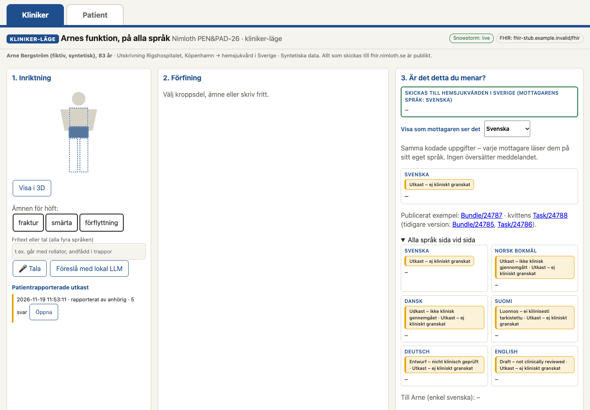 Clinician orientation: 2D body map + topic list (default) | 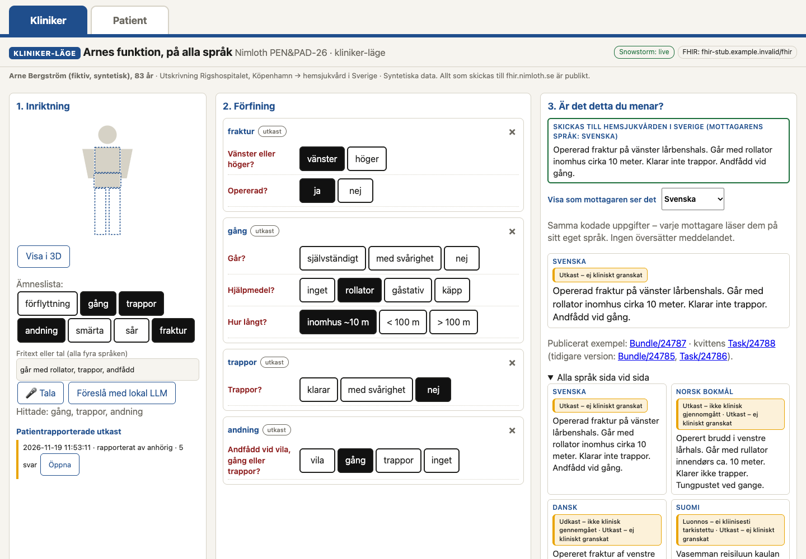 Refinement as short questions |
| 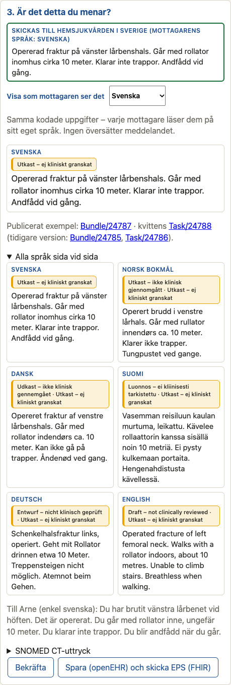 Sent in Swedish; the same record viewed in six languages, review status visible | 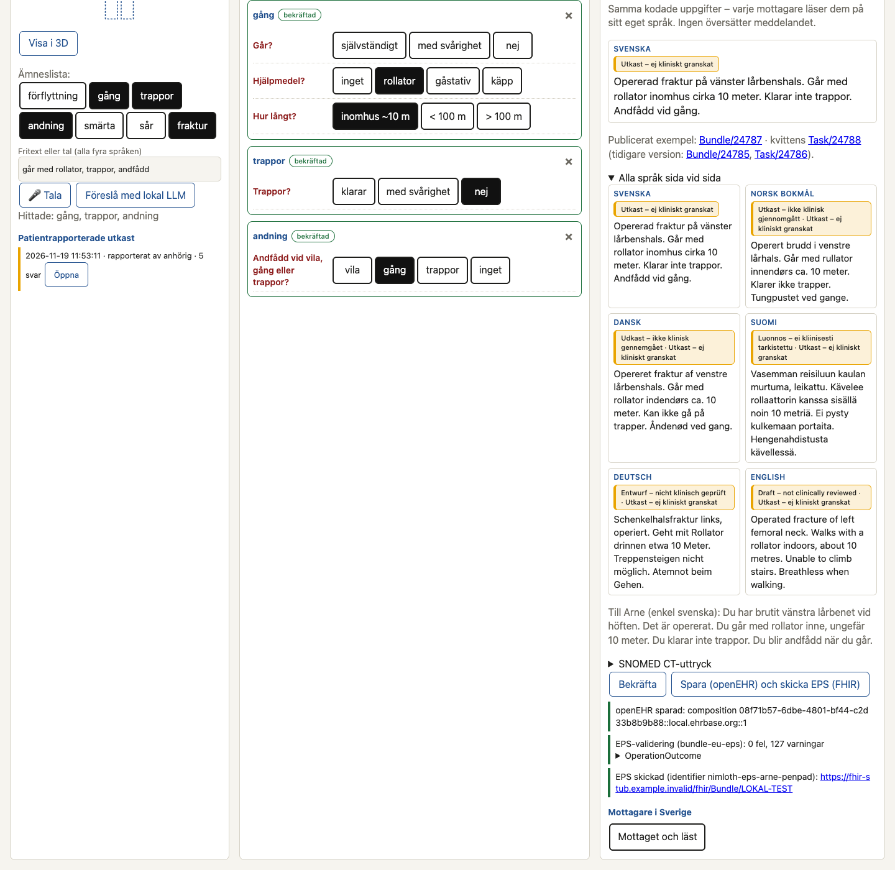 Save flow: openEHR saved, EPS validated (local rehearsal against a stub FHIR endpoint — the real publication is shown in 09/10) |
| 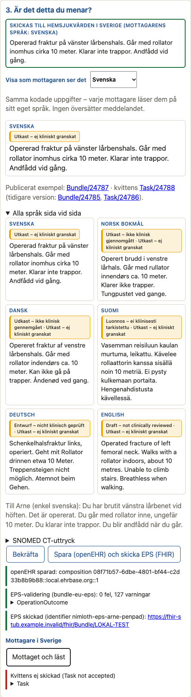 Receipt button in the UI (local rehearsal, stub FHIR) | 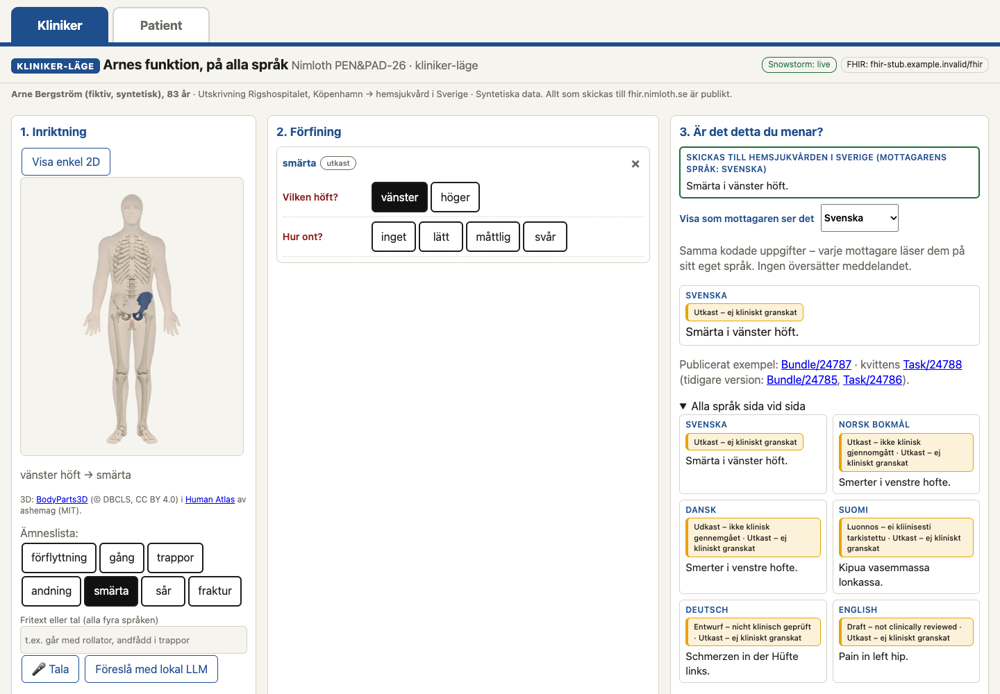 Clinician mode with "Visa i 3D" on: left hip → pain card, side pre-filled |
| 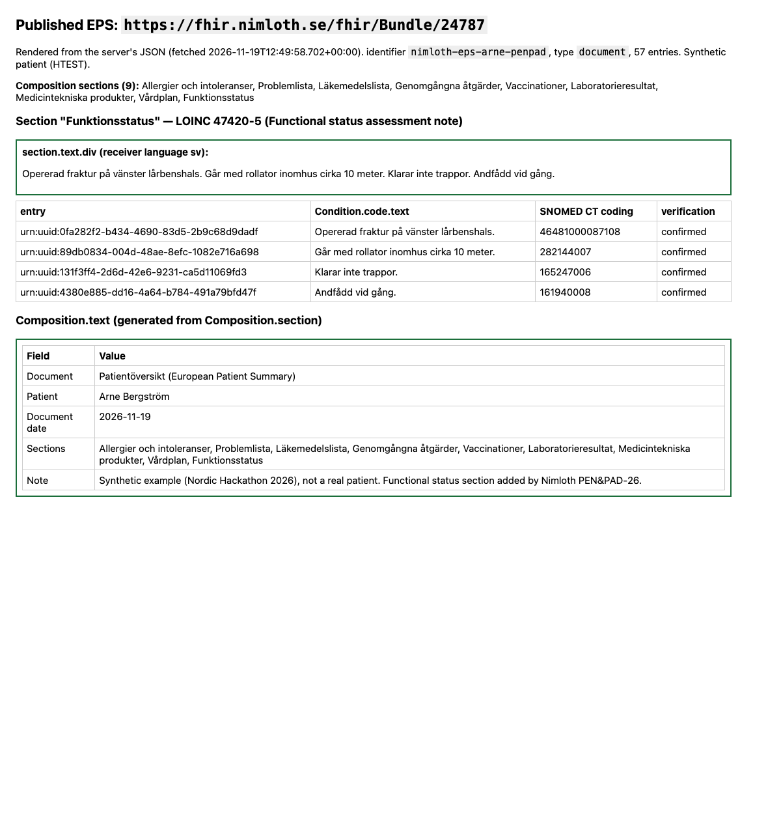 Published `Bundle/24787`: Functional status section and generated Composition narrative | 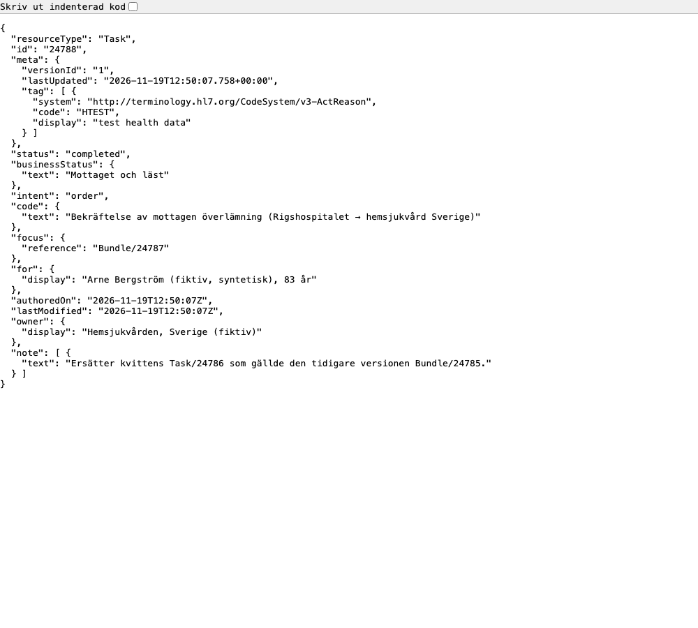 Published `Task/24788` (completed, focus `Bundle/24787`) |
| 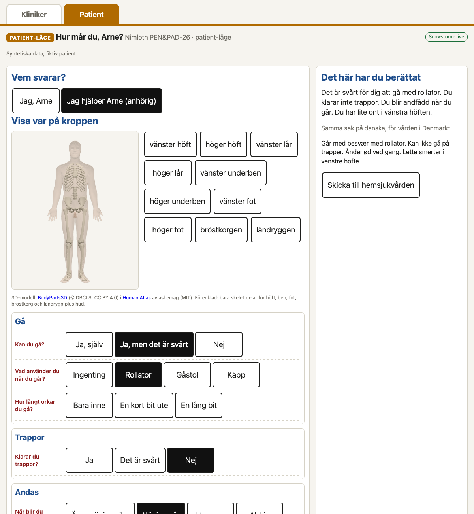 Patient mode (relative answering) | 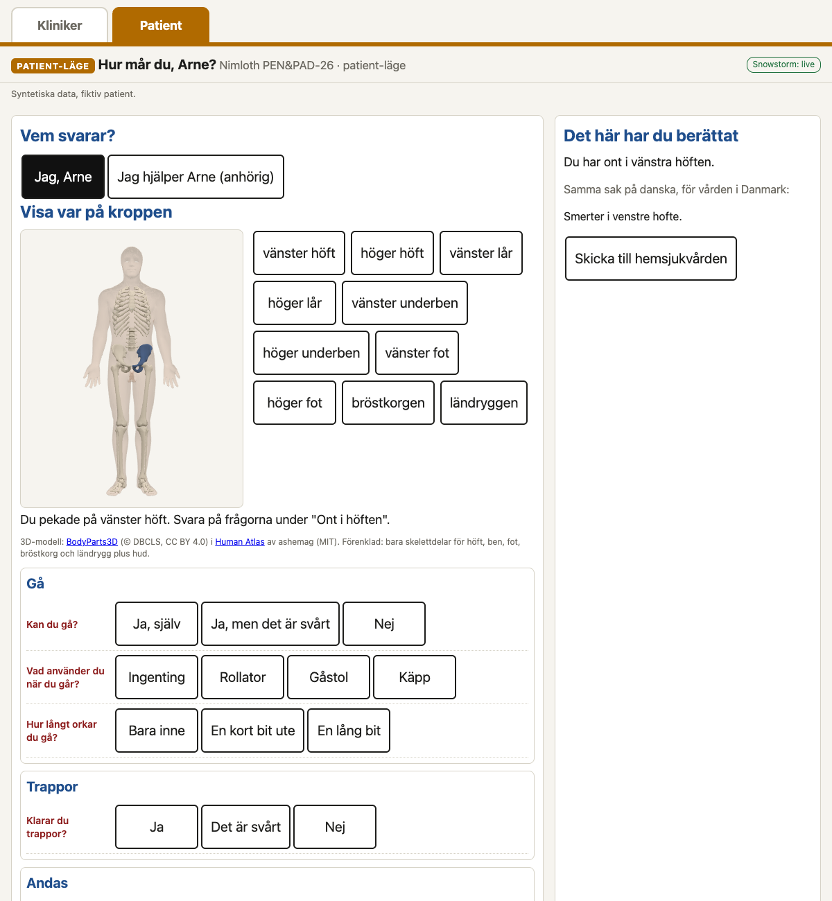 Arne points at his left hip in 3D → "Du har ont i vänstra höften." / "Smerter i venstre hofte." |
| 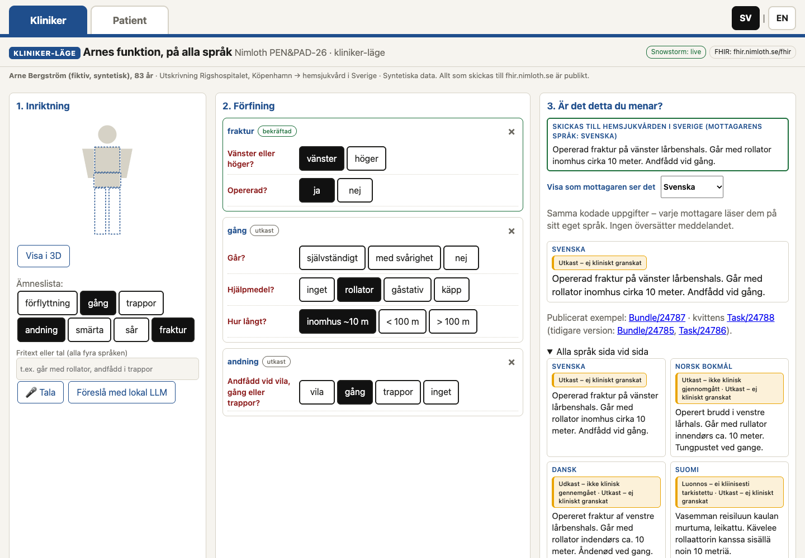 Clinician mode, Swedish interface | 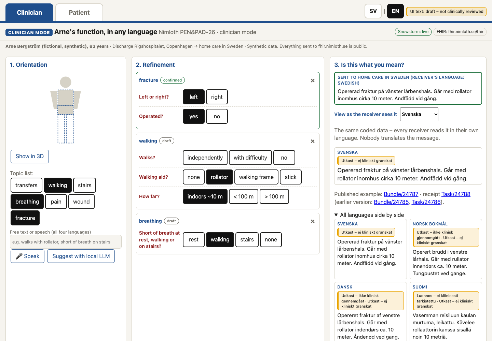 Clinician mode, English interface (draft_unreviewed); the record sent to Sweden stays Swedish |
| 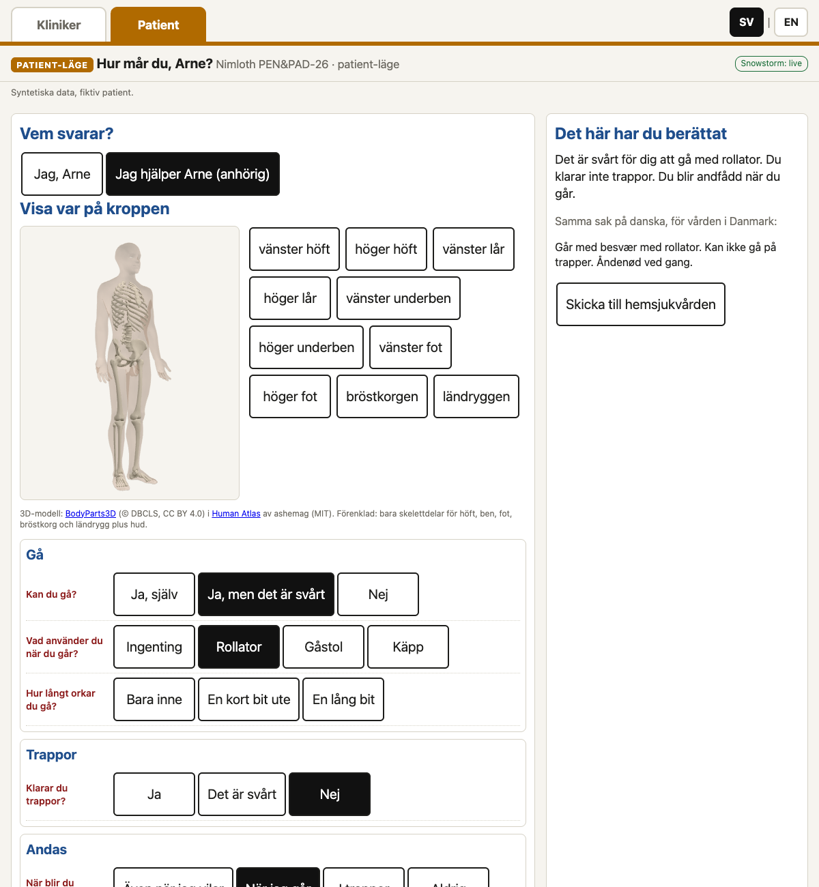 Patient mode, Swedish interface (plain Swedish) | 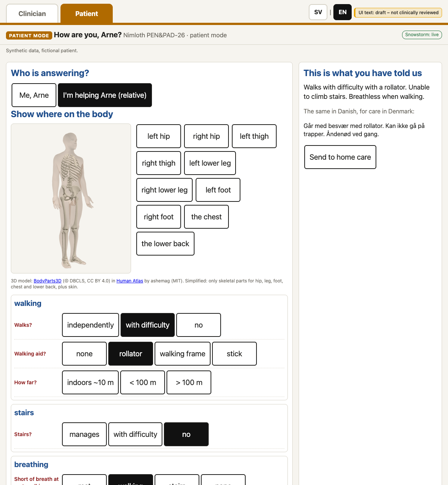 Patient mode, English interface (draft_unreviewed) |
