# Sendero: full consultation walkthrough

[Return to the briefing](readme.md)

Selected captures from the supplied “full-consultation” folder, captured on 20 November 2026. The interview and history views below follow the same pseudonymous person. The historical PROM responses are real data from the collaboration with a hospital pharmacy team using NAVETA. No real HIS data was used: the hospital context was generated synthetically. Today's interview selections demonstrate the workflow and are distinct from both the real PROM history and the synthetic hospital scenarios. Preparation images for a different identifier are not part of this sequence. All captions are in English; some original instrument labels and metadata remain in their source language.

## 1. Begin with the person's priority

The consultation opens with a choice of priorities, access to every topic and a separate history panel. Reviewing earlier sources does not answer today's questions. The hospital context in this capture is explicitly synthetic.

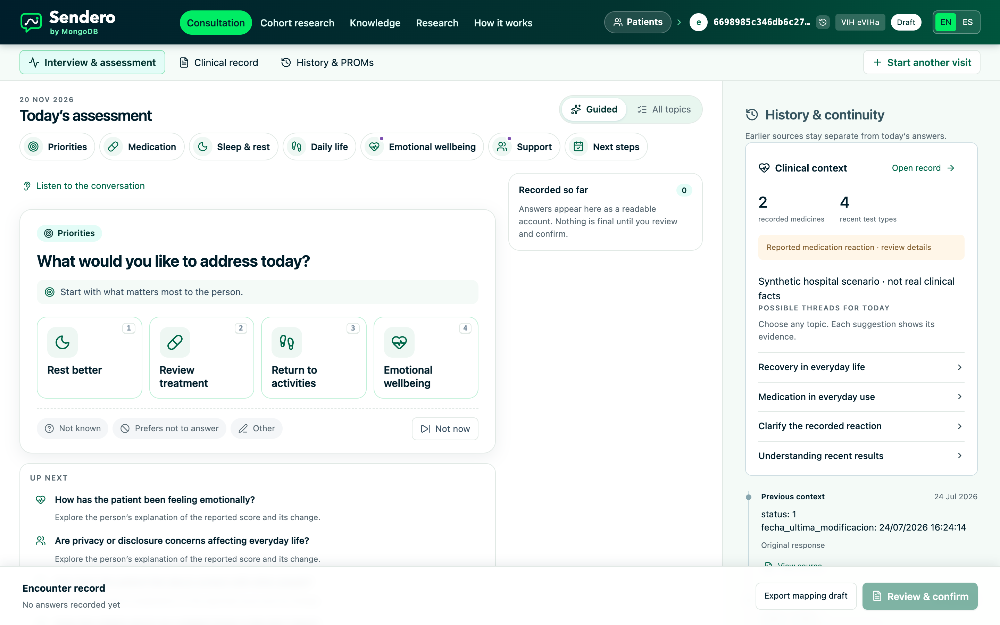

## 2. Bring three kinds of context to one question

The medication question shows the selected priority, a suggestion supported by comparable pathways, and the person's last report. The 12%/88% bars describe historical responses from the displayed comparison population; they are not probabilities for this individual. No answer to this question has yet entered today's draft.

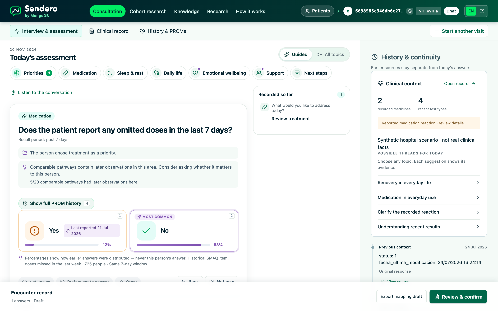

## 3. Inspect the original answers without leaving the interview

The expanded history shows a reported treatment-convenience score and individual medication-taking answers, with dates and version status. A general answer about forgetting and a specific answer about missed doses can require clarification; neither should silently overwrite the other. The chat text is blurred in the supplied image. Instrument names and source labels may retain their original language.

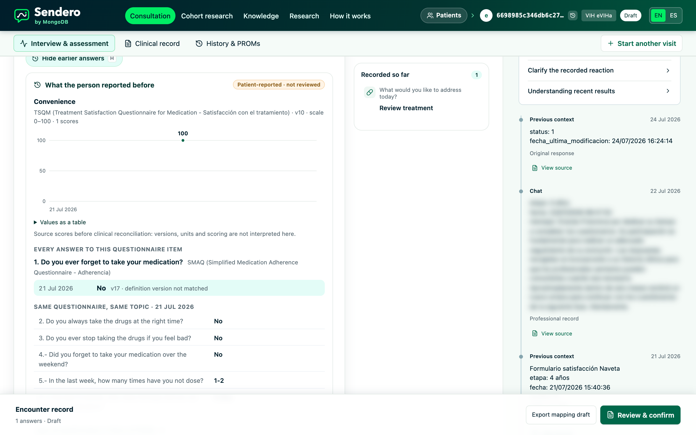

## 4. Change topic while retaining the developing account

After the demonstration selection of no omitted doses, the pharmacist can explore emotional wellbeing. The historical anxiety change remains evidence to discuss; it does not determine today's answer. The accumulated account remains visible.

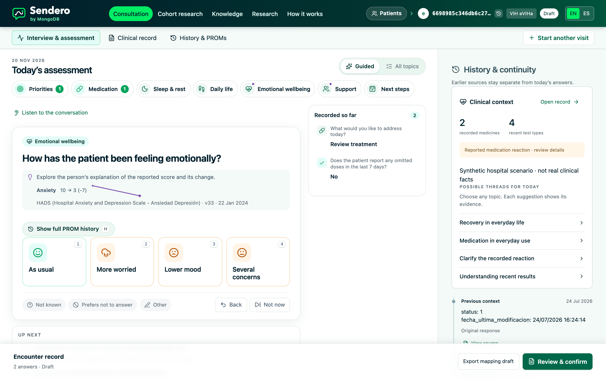

## 5. Refine a physical concern through location

A new physical concern exposes body-region choices. The parent statement and other recorded answers remain visible. Selecting a location is a refinement of a report, not a diagnosis.

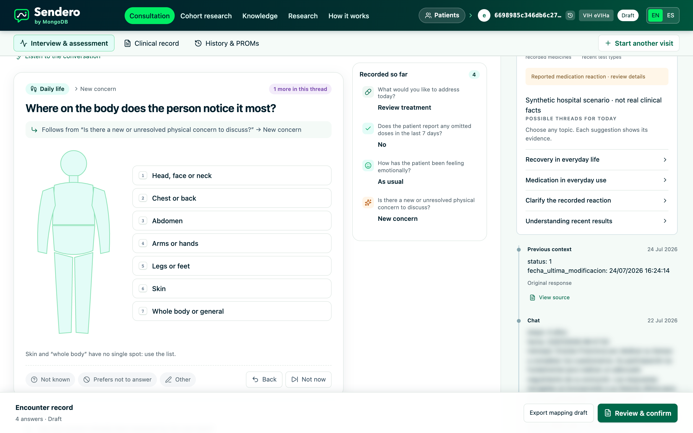

## 6. Go deeper without losing the rest of the conversation

A report of difficulty resting opens duration choices. Today's five demonstration selections remain in the account, while earlier context and the synthetic hospital scenario remain alongside. One selected answer is labelled as originating from speech; the screenshot does not establish speech-recognition accuracy or a live recording session.

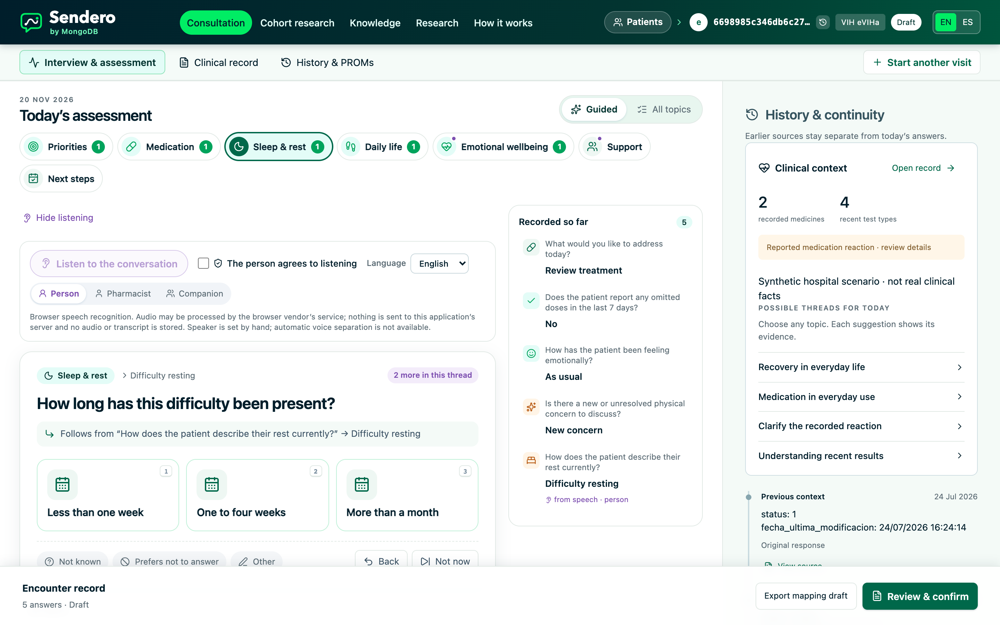

## 7. Review the meaning before confirming the record

The review lists the same selected answers used by the developing account. The mapping-draft label remains explicit. This is the review step before confirmation, not proof that this encounter has been submitted to an openEHR CDR.

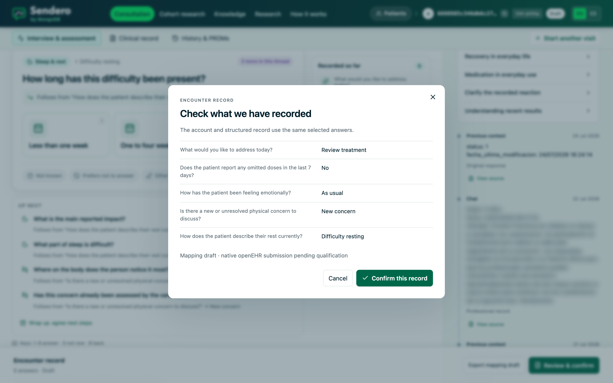

## 8. Return to evidence during the conversation

Historical score changes remain accessible after answers have been entered. Revisit topic, Later and Not relevant let the professional reconsider relevance. The dates identify older evidence, not a current clinical assessment.

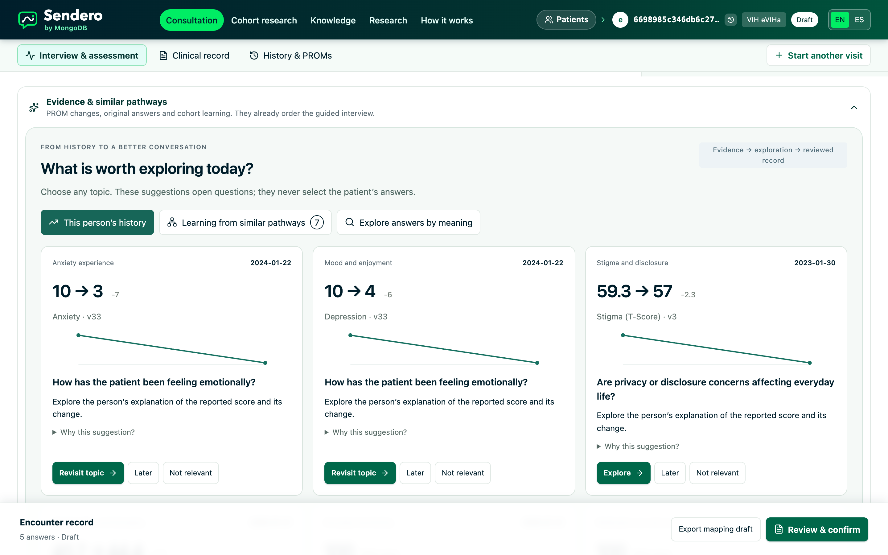

## 9. Extend the view beyond PROMs

The hospital view illustrates problems, medicines, episodes and laboratory series. Its synthetic scenario is attached to the same workspace but explicitly distinguished from imported PROM history. There is no live hospital EHR connection in this demonstration.

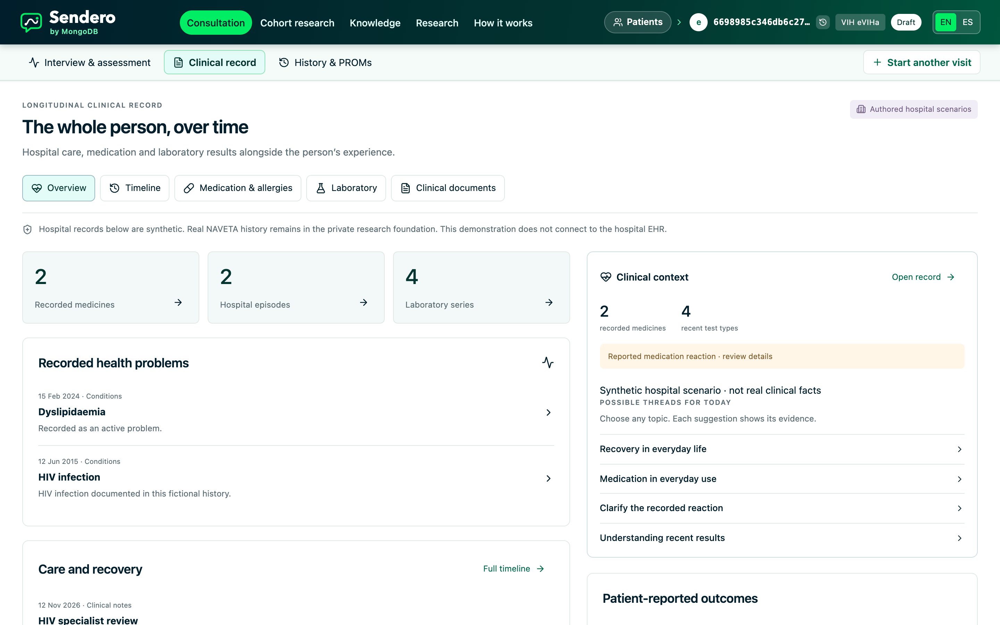

## 10. Inspect the comparison behind a suggested topic

The chart aligns a shared feature by days before each index assessment and exposes baseline, latest value, change and days observed. Similarity is descriptive. The selected comparator has no later observation in the shown 180-day window; this must not be interpreted as improvement.

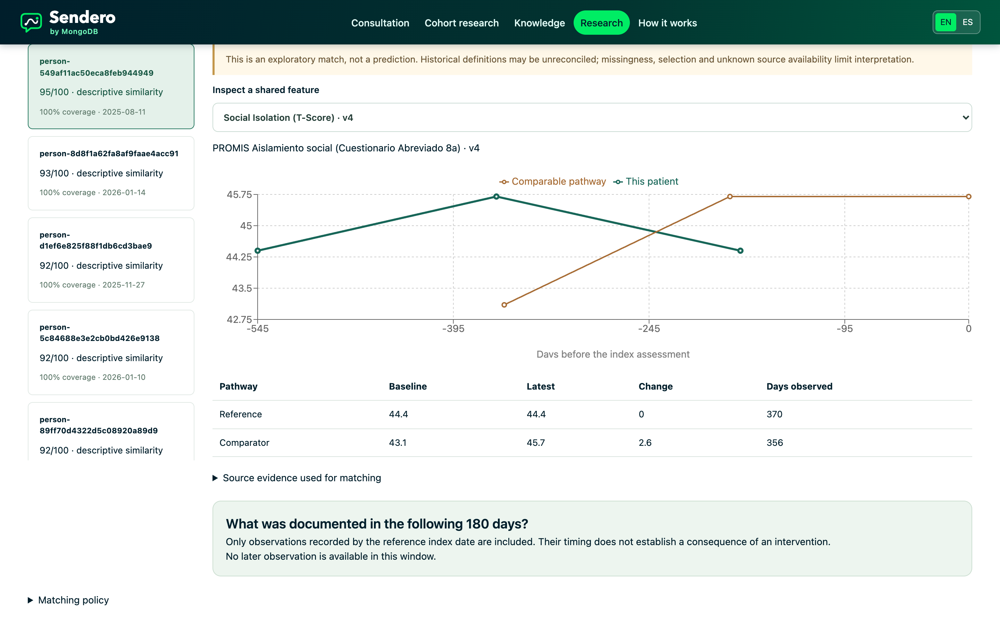

## 11. Inspect the concept-to-fragment model

The layered graph shows a combined sleep-and-medication assessment, its parent paths and reusable fragments. Source mappings and cohort associations have separate layers. This is a local authored assessment model, pending clinical review, not a live SNOMED CT or OpenGALEN classifier.

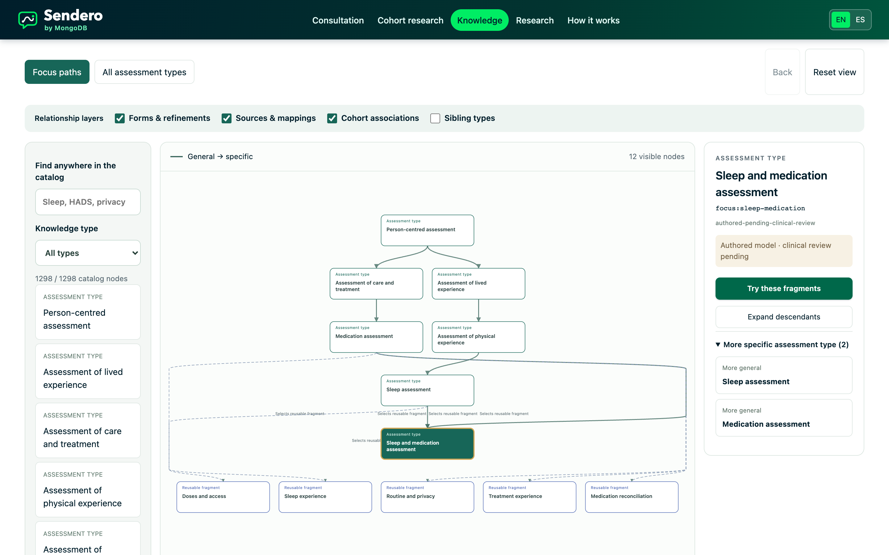

## 12. Explain how the parts work together

The knowledge explanation connects source-linked history, versioned mappings, optional questions, earlier-pathway matching, follow-up windows and reusable assessment fragments. Counts describe the loaded projection at capture time, not a prospective pilot sample. Running and pending capabilities are distinguished.

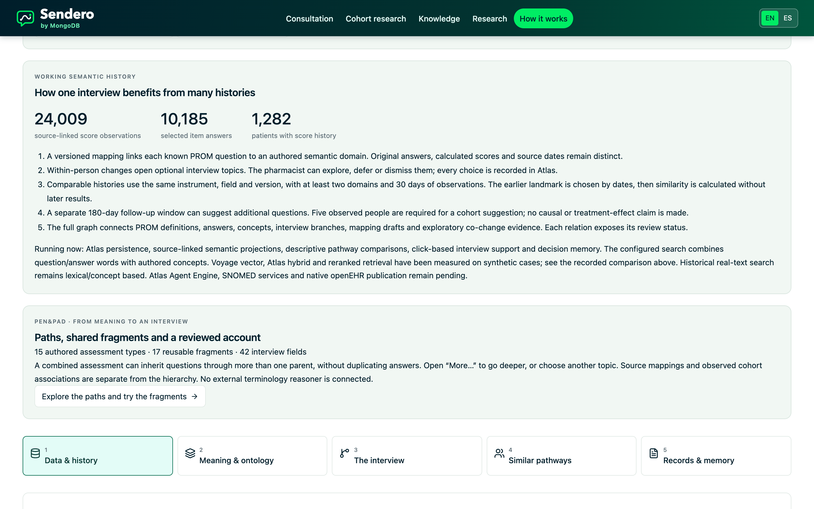

[Earlier screenshots and empty-state examples](earlier-gallery.md) · [openEHR technical evidence](technical/readme.md)
