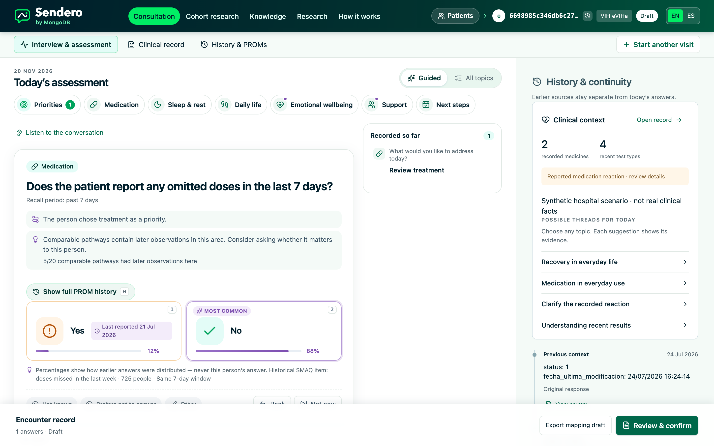
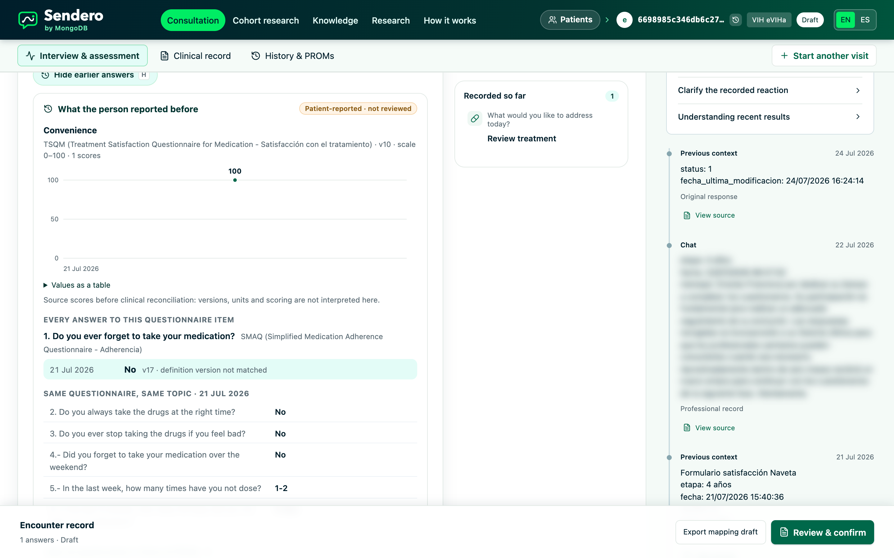
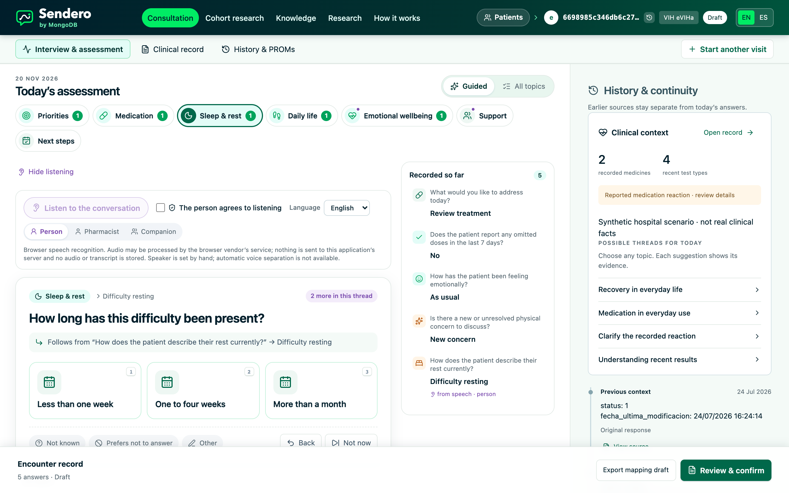
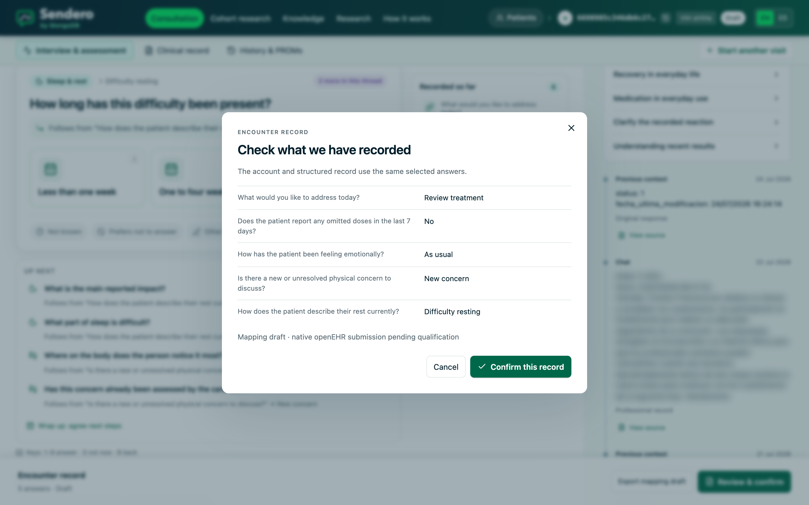
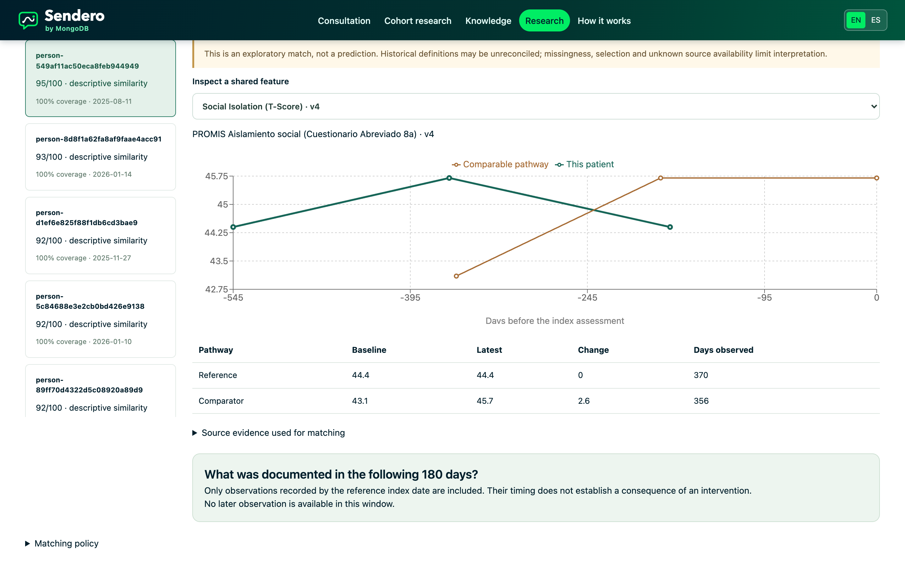
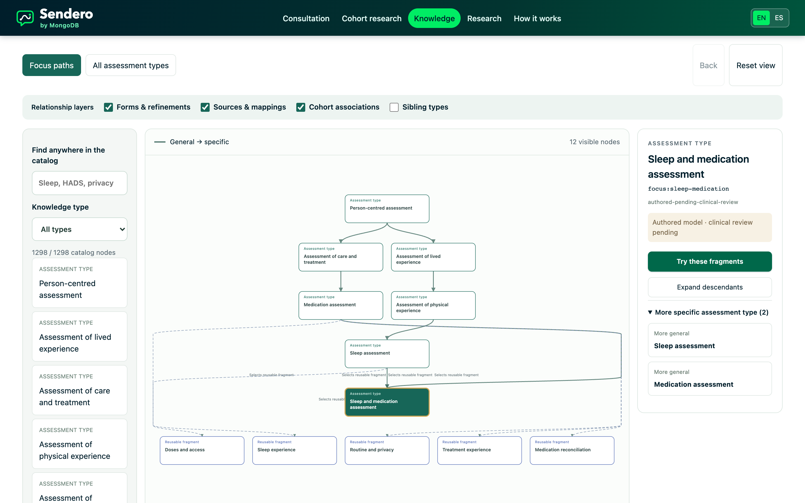

# Sendero: from clinical meaning to a confirmed record

**PEN&PAD revival bonus track · Nordic openEHR Hackathon 2026**

**Contributor:** Francesc Mateu, Field CTO, Healthcare, MongoDB

**Contact:** [francesc.mateu@mongodb.com](mailto:francesc.mateu@mongodb.com) · [GitHub: Paco-Mateu](https://github.com/Paco-Mateu)

A person arrives at the pharmacy to renew their HIV medication. Their earlier patient-reported outcome measure (PROM) responses already contain useful context. The pharmacist needs to understand what matters **today**, explore it naturally, and leave a record that preserves what was actually said and agreed.

**Sendero brings that context into a PEN&PAD-style consultation: target a concern, offer meaningful refinements, keep the developing account visible, and review it before confirmation.** Historical evidence helps the pharmacist choose what to explore. A versioned concept-and-fragment model supplies the available descriptions. openEHR provides the intended information structures for the resulting clinical record.

The prototype comes from a collaboration with a **hospital pharmacy team using NAVETA** to collect patient-reported questionnaires. **The historical PROM responses are real, not generated for the demonstration.** They provide the foundation for exploring how earlier answers and reported changes can support a more useful interview.

The loaded semantic projection shown in the demonstration contains:

| Historical PROM data | Count |
|---|---:|
| Source-linked score observations | 24,009 |
| Selected questionnaire item answers | 10,185 |
| Patients with score history | 1,282 |

These figures describe the loaded projection at capture time. They distinguish repeated observations and selected answers from distinct patients; they are not the size of a prospective pilot or a claim that every source item has been clinically reconciled.

**No real hospital information system (HIS) data was used for the wider clinical context.** Medication, allergies, admissions and laboratory results were generated synthetically to extend the real PROM foundation and demonstrate how future hospital integration could inform the same consultation. These scenarios remain explicitly labelled and do not establish clinical facts about the people whose PROM history is shown. Today's on-screen interview selections are demonstration inputs; the real source data underpinning this submission are the historical PROM records.

Its interface is branded “Sendero by MongoDB”; it is not an officially released MongoDB product. The next step is a pilot with a pharmacist to assess practicality, semantic fidelity and what needs improving.



This screen captures the central idea. The person has chosen **Review treatment**. The pharmacist sees a question about omitted doses, the last reported answer, the distribution of earlier responses and a reason to explore the topic from comparable pathways. These are different kinds of evidence: none supplies today's answer. The middle column contains today's developing account; the right-hand panel holds earlier context and a clearly labelled synthetic hospital scenario.

## Walk through a complete consultation

The selected sequence follows the same pseudonymous person through the interview and related history views. The source folder also contains preparation images for another identifier; those have not been spliced into this sequence. Historical PROM values are imported evidence, the on-screen interview selections demonstrate the workflow, and hospital facts are explicitly synthetic. The screenshots do not document a prospectively evaluated clinical encounter.

**1. Start with the person's priority and keep other topics available.** The [opening screen](screenshots/full-consultation/06-guided-first-question.png) offers treatment, rest, activities and emotional wellbeing. Guided mode makes a next step easy; the topic tabs and All topics option preserve freedom to change direction. A new patient can use the same fragments with no prior evidence.

**2. Look behind a score or a previous answer.** “Show full PROM history” opens the supporting material inside the interview, rather than sending the pharmacist to a disconnected dashboard.



This is where semantic understanding becomes useful. A reported convenience score, a general answer about forgetting medication, and an answer about missed doses in a specific recall period are related but not interchangeable. Sendero keeps the item wording, date and version status visible. The pharmacist can clarify apparent tensions instead of reducing everything to one adherence label. A displayed definition-version mismatch remains unresolved until reviewed.

**3. Follow the conversation across topics and into detail.** After discussing medication, the pharmacist can [explore emotional wellbeing](screenshots/full-consultation/09-follow-up-question.png), locate a [physical concern on a body map](screenshots/full-consultation/11-body-map.png), or examine sleep. The account retains the other selected answers.



Here, **Difficulty resting** leads to duration choices while medication, mood and physical concerns remain in view. This is the PEN&PAD refinement mechanism: a selected meaning exposes appropriate further descriptions. The professional chooses the depth and can leave a detail unanswered. Negative, unknown, declined and unanswered states remain distinct. Correcting a parent answer removes incompatible descendants from the active draft while retaining the change in its trace.

Click-based entry is the primary interaction. Optional speech-derived proposals need explicit acceptance before entering the account; speaker selection is manual, and browser speech processing may use the browser vendor's service. The screenshot is evidence of the interface state, not a measurement of recognition accuracy.

**4. Review what this consultation has recorded.** The readable account and structured draft use the same selected answers. The professional can correct them before confirming the intended version.



The visible **mapping draft** status matters: confirming an encounter snapshot is separate from qualifying its openEHR mapping. This capture shows the review step, not a successful clinical CDR submission. The bounded technical example below demonstrates that separate validation path.

## One interview benefits from many histories

The [evidence panel](screenshots/full-consultation/14-evidence-during-interview.png) remains available during the interview. A change in a reported score can suggest an optional topic, with Explore or Revisit topic, Later and Not relevant controls. An old score remains an old score; it is not silently treated as the person's current state.

Comparable pathways add another source of questions. Matching uses earlier observations of the same instrument, field and version, with coverage and observed duration made explicit. Later observations are examined separately to suggest areas worth asking about. For example, the medication screen reports later observations in that area for **5 of 20** displayed comparable pathways. That is follow-up availability, not a treatment success rate or the probability of this person's answer.



The comparison exposes the trajectories, index-relative time and underlying summary values. The selected comparator has no later observation in the displayed 180-day window. That absence is not improvement. These exploratory comparisons help identify a possible question; they do not establish causation, treatment effects or a prediction.

The [wider clinical record](screenshots/full-consultation/18-clinical-record.png) illustrates how medication, reported reactions, hospital episodes and laboratory results can provide additional context. Its hospital scenario is explicitly synthetic and does not connect to a live hospital EHR. A prescription is different from actual use; a reported reaction is different from a verified allergy. Those distinctions need to survive both the conversation and the eventual record mapping.

## Why this belongs in the PEN&PAD bonus track

The [Clinergy walkthrough](https://pen-pad-revival.github.io/docs/clinergy-thumb-pain-demo/) and [Alan Rector's discussion of concepts and archetype-sized fragments](https://pen-pad-revival.github.io/interviews/alan-rector-part-4/) informed the design. The reusable mechanism is the connection from a clinical meaning to appropriate recording fragments, further refinements and a reviewable account.

| PEN&PAD principle | What the prototype demonstrates |
|---|---|
| Target a concern | Enter through a priority, topic, evidence card or physical location. |
| Compose relevant recording structure | Versioned assessment types select reusable fragments; combined types inherit shared fragments once. |
| Refine the meaning | Answer-dependent details retain the parent statement and the developing account. |
| Preserve professional control | Suggested questions coexist with other topics, deferral and correction. |
| Confirm the intended statement | Review the same selected meanings before confirming a versioned snapshot. |

The [OpenGALEN browser](https://erik-sundvalls-bots.github.io/opengalen-browser/#concept=Asthma) inspired a layered, general-to-specific graph with multiple parent paths.



The graph exposes the model behind the interface. Hierarchy, form refinements, source mappings and cohort associations are distinct relationships. A cohort association cannot create a subtype or a confirmed patient fact. This is an authored local assessment ontology, not the full SNOMED CT ontology or a live OpenGALEN/GRAIL classifier. We adapted the principles without copying Clinergy assets, OpenGALEN terminology data or its browser code.

## Four models, with explicit connections


The ontology is not the patient's record, and a terminology code is not a complete clinical statement.

| Layer | Responsibility |
|---|---|
| **Concept model** | Stable meanings and explicit subtype relationships. The current local assessment taxonomy supports multiple inheritance. |
| **Interaction model** | Reusable fragments, permitted answers, applicability and refinements; labels and summary wording are separate from stable identifiers. |
| **Information model** | openEHR archetypes and templates constrain the structure used to represent clinical information, including subject, time, authorship and values. |
| **Evidence and assistance** | Source material, historical trajectories and retrieval results can suggest something to explore. An association does not become a subtype relationship or a confirmed patient fact. |

The intended recording chain is:

```text
Clinical concern -> applicable fragment -> selected answer + qualifiers
                 -> readable review -> confirmed encounter snapshot
                 -> reviewed mapping -> validated openEHR COMPOSITION
```

The last step is qualified separately. The general interview currently produces mapping drafts; the bounded openEHR example below demonstrates the technical structure and validation path.

## openEHR: concrete technical evidence and its boundary

This submission includes a [synthetic canonical COMPOSITION](technical/openehr-hads.synthetic.json), containing two authored HADS subscale values in an `OBSERVATION`. It uses an event `COMPOSITION`, an observation history and point event, an item tree, and typed `DV_COUNT` values. The template identity, archetype identity, event time, language and composer are explicit.

The example passed:

- The pinned **openEHR RM 1.0.4 JSON schema**, with the root required to be a `COMPOSITION`.
- The prototype's local validator against its registered `hads_v0` operational template.
- Additional bounded checks for the two subscales, their integer ranges, subject, identity and consistent timezone-aware event times.
- A previously executed **MongoDB Atlas write/read-back**, including independent-client equality and validation of the retrieved composition. The packaged example's canonical digest matches that recorded result.

See the [technical note, validation result and round-trip record](technical/readme.md). These are engineering checks on a synthetic example. They do **not** establish clinical approval of the template, full RM invariant conformance, terminology qualification, or interoperability with an external openEHR clinical data repository. Storing canonical JSON in Atlas does not make Atlas an openEHR CDR.

For a complete clinical interview, entry types must follow the meaning of the information: a reported measurement may be an `OBSERVATION`, an assessment an `EVALUATION`, and a plan or performed activity may need `INSTRUCTION` or `ACTION` structures. We do not force every answer into an observation or generate arbitrary templates from conversation.

## How the technology supports the consultation

**MongoDB Atlas** stores knowledge assets, patient evidence, encounter drafts, confirmations and decision traces. Source-linked projections connect question/answer meaning to interview topics while retaining instrument identity, dates and review status. The [“one interview, many histories” explanation](screenshots/full-consultation/24-one-interview-many-histories.png) makes this mechanism inspectable. Its displayed counts describe the historical PROM projection summarised above, not a prospective pilot sample.

**Search and retrieval** help find candidate evidence across wording. Historical real-text search currently uses lexical and authored-concept matching. Atlas Search, Voyage embeddings, vector retrieval, hybrid search and reranking have also been exercised on a small synthetic, author-judged bilingual reference set. This is engineering evidence, not clinical validation; absent-evidence queries still need a qualified abstention policy. Neither semantic similarity nor a high retrieval score establishes a clinical fact.

**Terminology and agents** have explicit boundaries. Edition-specific SNOMED CT bindings, a live terminology reasoner and the separate MongoDB Agent Engine integration remain pending. The prototype does not extract a clinically approved ontology from raw conversations or automatically promote observed cohort associations into clinical rules.

## What we will learn in the pharmacist pilot

The planned pilot with the hospital pharmacy team will examine whether this interaction is practical in medication-renewal interviews: whether it surfaces relevant context, captures the intended meaning, permits natural topic changes and reduces correction or documentation burden. Interview time, useful details captured, missed details and the usefulness of suggestions are appropriate initial measures. Improved clinical outcomes have not been demonstrated.

The next interoperability step is a pharmacist-reviewed set of fragments connected to clinically reviewed openEHR templates and current terminology bindings, followed by an external CDR round-trip. The reusable contribution is the **versioned contract between meaning, evidence, available refinements and a confirmed record**.

## Submission contents

- [Full consultation walkthrough and image captions](gallery.md)
- [Synthetic openEHR example and technical validation evidence](technical/readme.md)
- [Earlier screenshots and empty-state examples](earlier-gallery.md)
- [PEN&PAD revival portal](https://pen-pad-revival.github.io/)
- [OpenGALEN browser source and documentation](https://github.com/erik-sundvalls-bots/opengalen-browser)

The briefing and captions are in English. Some source instrument names and metadata in the English interface retain their original language. Selected historical values appear under pseudonymous identifiers; original CSVs, readable chat exports, credentials and application source code are not included. Chat text is blurred in the supplied inline-history image. There is no publicly hosted live service in this submission; contact the contributor for a walkthrough.
