# Join the PEN&PAD revieval community!

This is the humble beginning of a website for the PEN &amp; PAD revival community - https://pen-pad-revival.github.io

* [PEN&PAD, GALEN & GRAIL: Thoughts on lessons learned - DRAFT - Nov 2026](assets/PEN-PAD-GALEN-GRAIL.pdf). By Alan Rector (PDF)

## [Interviews](https://github.com/pen-pad-revival/interviews/)

### A conversation with Alan Rector about PEN&PAD, recorded in 4 parts, October 21, 2021
Alan Rector, a central researcher in the PEN&PAD approach to electronic health records, in a conversation with Erik Sundvall and Daniel Karlsson

The transcripts on the part pages were machine-assisted and then proofread, and they may still contain errors. Please send corrections as an [issue](https://github.com/pen-pad-revival/pen-pad-revival.github.io/issues/new) or a pull request on the transcript file in the [PEN&PAD revival site repository](https://github.com/pen-pad-revival/pen-pad-revival.github.io); each part page links to its file, and the subtitle files are regenerated from the transcript.

<link rel="stylesheet" href="/assets/css/home-interviews.css">
<section class="home-film" id="home-film-1">
  <h4 class="home-film-title"><a href="interviews/alan-rector-part-1/">1. Intro &amp; Demo of PEN&amp;PAD</a> <a class="home-film-more" href="interviews/alan-rector-part-1/">[Click for other video formats, full transcript, links etc.]</a></h4>
  <ul class="home-film-points">
    <li>Who is Alan Rector and how did he get involved in this?</li>
    <li>What was PEN&amp;PAD? (Including live demo of the PEN &amp; PAD-based Clinergy user interface)</li>
    <li>Where did it lead?</li>
  </ul>
  

    

      <video id="home-film-player-1" controls preload="metadata" playsinline>
        <source src="https://archive.org/download/pen-pad-interview-alan-rector-part1/pen-pad-interview-alan-rector-part1_1080p.mp4" type="video/mp4">
        <track kind="subtitles" srclang="en" label="English" src="/assets/interviews/part-1/pen-pad-interview-alan-rector-part1.en.vtt" default>
      </video>
    

    

      <ol>
        <li><a class="home-chapter" href="interviews/alan-rector-part-1/#t=0" data-start="0">0:00 Who is Alan Rector and how did he get involved in this? An innovative research environment.</a></li>
        <li><a class="home-chapter" href="interviews/alan-rector-part-1/#t=83" data-start="83">1:23 &#x27;Expert systems&#x27; for clinicians - &#x27;bonkers idea&#x27; - but the user centered research gave birth to the PEN&amp;PAD approach.</a></li>
        <li><a class="home-chapter" href="interviews/alan-rector-part-1/#t=261" data-start="261">4:21 (Anecdote - the Arnold Schwarzenegger laptop)</a></li>
        <li><a class="home-chapter" href="interviews/alan-rector-part-1/#t=312" data-start="312">5:12 User centered design + the &quot;swiss army knife&quot; of knowledge representation (description logics, GALEN etc.)</a></li>
        <li><a class="home-chapter" href="interviews/alan-rector-part-1/#t=393" data-start="393">6:33 The ICD-11 project and it&#x27;s relation to SNOMED CT</a></li>
        <li><a class="home-chapter" href="interviews/alan-rector-part-1/#t=685" data-start="685">11:25 Live demo of the PEN &amp; PAD-based Clinergy user interface, explained by Alan</a></li>
        <li><a class="home-chapter" href="interviews/alan-rector-part-1/#t=1339" data-start="1339">22:19 Was it used? What eventually killed PEN&amp;PAD and GALEN commercially?</a></li>
        <li><a class="home-chapter" href="interviews/alan-rector-part-1/#t=1524" data-start="1524">25:24 What about user Acceptance? Could &#x27;death by a thousand clicks&#x27; be avoided? Different user preferences, keyboard shortcuts etc.</a></li>
        <li><a class="home-chapter" href="interviews/alan-rector-part-1/#t=1738" data-start="1738">28:58 &#x27;The user is always right, but they are usually wrong&#x27;</a></li>
        <li><a class="home-chapter" href="interviews/alan-rector-part-1/#t=1789" data-start="1789">29:49 Ahead of it&#x27;s time &amp; technological challenges. + Info about interview parts 2 &amp; 3</a></li>
        <li><a class="home-chapter" href="interviews/alan-rector-part-1/#t=1918" data-start="1918">31:58 About generating &#x27;Read codes&#x27; (Bonus track)</a></li>
        <li><a class="home-chapter" href="interviews/alan-rector-part-1/#t=1973" data-start="1973">32:53 The end</a></li>
      </ol>
    

  

  <ul class="home-film-thumbs">
    <li>
      <a class="home-thumb" href="interviews/alan-rector-part-1/#t=268" data-start="268">
        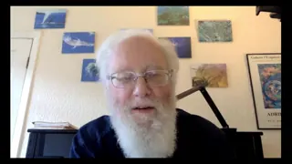
        4:28 The &#x27;Arnold Schwarzenegger laptop&#x27;
      </a>
    </li>
    <li>
      <a class="home-thumb" href="interviews/alan-rector-part-1/#t=750" data-start="750">
        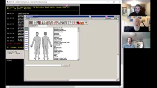
        12:30 The homunculus — body-map drawings for entering symptoms
      </a>
    </li>
    <li>
      <a class="home-thumb" href="interviews/alan-rector-part-1/#t=870" data-start="870">
        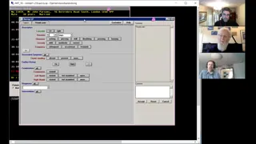
        14:30 The Thumb pain form — large, easy-to-click fields
      </a>
    </li>
  </ul>
  
<a href="https://youtu.be/PGEAmJJ4frU">Also on YouTube</a>

</section>
<section class="home-film" id="home-film-2">
  <h4 class="home-film-title"><a href="interviews/alan-rector-part-2/">2. The User Centered Design Process, Human Factors, Problem &amp; Solution Space</a> <a class="home-film-more" href="interviews/alan-rector-part-2/">[Click for other video formats, full transcript, links etc.]</a></h4>
  

    

      <video id="home-film-player-2" controls preload="metadata" playsinline>
        <source src="https://archive.org/download/pen-pad-interview-alan-rector-part2/pen-pad-interview-alan-rector-part2_1080p.mp4" type="video/mp4">
        <track kind="subtitles" srclang="en" label="English" src="/assets/interviews/part-2/pen-pad-interview-alan-rector-part2.en.vtt" default>
      </video>
    

    

      <ol>
        <li><a class="home-chapter" href="interviews/alan-rector-part-2/#t=0" data-start="0">0:00 How the user centered design ideas came about: workshops with GPs, programmers and psychologists</a></li>
        <li><a class="home-chapter" href="interviews/alan-rector-part-2/#t=113" data-start="113">1:53 Photos from the workshops (&#x27;three ring circuses&#x27;) - circular menus and radio buttons were a disaster; actors playing patients</a></li>
        <li><a class="home-chapter" href="interviews/alan-rector-part-2/#t=252" data-start="252">4:12 Rapid prototyping in Smalltalk - &#x27;cardboard&#x27; interfaces built before the guts behind them; useful and usable</a></li>
        <li><a class="home-chapter" href="interviews/alan-rector-part-2/#t=333" data-start="333">5:33 Summarizing the medical record: problem lists, graphs and timelines - &#x27;exhaustive is the enemy of the useful&#x27;</a></li>
        <li><a class="home-chapter" href="interviews/alan-rector-part-2/#t=419" data-start="419">6:59 Typing and Read codes by heart - fast paths for experienced users</a></li>
        <li><a class="home-chapter" href="interviews/alan-rector-part-2/#t=501" data-start="501">8:21 Tailoring to each doctor and practice - favourite prescriptions, and AI for personalization today?</a></li>
        <li><a class="home-chapter" href="interviews/alan-rector-part-2/#t=616" data-start="616">10:16 Different forms for different trials, CLEF - &#x27;it&#x27;s very easy to do things that aren&#x27;t helpful&#x27;</a></li>
        <li><a class="home-chapter" href="interviews/alan-rector-part-2/#t=720" data-start="720">12:00 &#x27;Death by a thousand clicks&#x27; - throwing out a prototype isn&#x27;t painful. Low code/no code prototyping today? &#x27;Essential.&#x27;</a></li>
        <li><a class="home-chapter" href="interviews/alan-rector-part-2/#t=802" data-start="802">13:22 What works in general practice doesn&#x27;t work everywhere: geriatrics, radiologists and light boxes</a></li>
        <li><a class="home-chapter" href="interviews/alan-rector-part-2/#t=937" data-start="937">15:37 One record system for the whole hospital and general practice? Modules and tailoring (cath lab, dermatology photos)</a></li>
        <li><a class="home-chapter" href="interviews/alan-rector-part-2/#t=1049" data-start="1049">17:29 Individual options per doctor, and typing or voice into a big tree - record exactly what was said, or offer alternatives?</a></li>
        <li><a class="home-chapter" href="interviews/alan-rector-part-2/#t=1316" data-start="1316">21:56 &#x27;Medicine is a humanly impossible task&#x27; and a wicked problem - errors, interruptions and reminders</a></li>
        <li><a class="home-chapter" href="interviews/alan-rector-part-2/#t=1516" data-start="1516">25:16 You don&#x27;t need a computer to fix everything (incompatible gas connectors, coloured syringes) - but slow deterioration is hard to catch</a></li>
        <li><a class="home-chapter" href="interviews/alan-rector-part-2/#t=1670" data-start="1670">27:50 The end</a></li>
      </ol>
    

  

  <ul class="home-film-thumbs">
    <li>
      <a class="home-thumb" href="interviews/alan-rector-part-2/#t=150" data-start="150">
        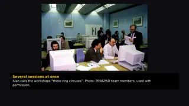
        2:30 Workshop photo: &#x27;three-ring circuses&#x27;
      </a>
    </li>
    <li>
      <a class="home-thumb" href="interviews/alan-rector-part-2/#t=185" data-start="185">
        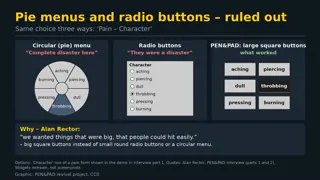
        3:05 Pie menus and radio buttons — ruled out
      </a>
    </li>
    <li>
      <a class="home-thumb" href="interviews/alan-rector-part-2/#t=270" data-start="270">
        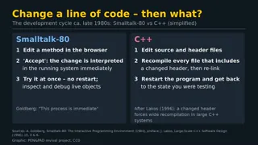
        4:30 Change a line of code — then what? Smalltalk-80 vs C++
      </a>
    </li>
  </ul>
</section>
<section class="home-film" id="home-film-3">
  <h4 class="home-film-title"><a href="interviews/alan-rector-part-3/">3. Technical details, terminology systems, ontologies and logic</a> <a class="home-film-more" href="interviews/alan-rector-part-3/">[Click for other video formats, full transcript, links etc.]</a></h4>
  

    

      <video id="home-film-player-3" controls preload="metadata" playsinline>
        <source src="https://archive.org/download/pen-pad-interview-alan-rector-part3/pen-pad-interview-alan-rector-part3_1080p.mp4" type="video/mp4">
        <track kind="subtitles" srclang="en" label="English" src="/assets/interviews/part-3/pen-pad-interview-alan-rector-part3.en.vtt" default>
      </video>
    

    

      <ol>
        <li><a class="home-chapter" href="interviews/alan-rector-part-3/#t=0" data-start="0">0:00 The technology and semantics underneath: tailoring forms beyond hand programming meets knowledge representation</a></li>
        <li><a class="home-chapter" href="interviews/alan-rector-part-3/#t=124" data-start="124">2:04 SMK, later GRAIL - a language for &#x27;conceptual Lego&#x27;; frame systems and tangled semantic networks</a></li>
        <li><a class="home-chapter" href="interviews/alan-rector-part-3/#t=293" data-start="293">4:53 Inheriting the most specific things and collecting them onto a form (the hypertension example)</a></li>
        <li><a class="home-chapter" href="interviews/alan-rector-part-3/#t=427" data-start="427">7:07 Extrinsics in GALEN, and normalizing the ontology: primitive trees stuck together with properties</a></li>
        <li><a class="home-chapter" href="interviews/alan-rector-part-3/#t=560" data-start="560">9:20 Pulling apart part-whole, function and structure - primitive hierarchies without exceptions (supernumerary fingers, dextrocardia: &#x27;it&#x27;s biology, not physics&#x27;)</a></li>
        <li><a class="home-chapter" href="interviews/alan-rector-part-3/#t=797" data-start="797">13:17 Classifiers and most specific generalizations (more in the &#x27;On beyond Gruber&#x27; paper)</a></li>
        <li><a class="home-chapter" href="interviews/alan-rector-part-3/#t=971" data-start="971">16:11 Collecting forms, treatments and codes (ICD, Read codes); negation in description logics and the need for queries</a></li>
        <li><a class="home-chapter" href="interviews/alan-rector-part-3/#t=1122" data-start="1122">18:42 Querying an OWL ontology - the &#x27;hypertension not in pregnancy&#x27; trap</a></li>
        <li><a class="home-chapter" href="interviews/alan-rector-part-3/#t=1292" data-start="1292">21:32 Why check after classification? Errors propagate - getting the foot out of the pelvis in SNOMED</a></li>
        <li><a class="home-chapter" href="interviews/alan-rector-part-3/#t=1498" data-start="1498">24:58 12 hours per classifier run - regression queries &#x27;just like software testing&#x27;; user interfaces and language generation as QA</a></li>
        <li><a class="home-chapter" href="interviews/alan-rector-part-3/#t=1729" data-start="1729">28:49 Pre- or post-coordination? Clean, normalized hierarchies; axioms vs generalizations (penicillins, Tweety the bird)</a></li>
        <li><a class="home-chapter" href="interviews/alan-rector-part-3/#t=2042" data-start="2042">34:02 Modular ontologies and property patterns - contributions to OWL</a></li>
        <li><a class="home-chapter" href="interviews/alan-rector-part-3/#t=2151" data-start="2151">35:51 Final words for techies: the same technique in ICD-11, queries to coordinate SNOMED and ICD, &#x27;rigid&#x27; properties</a></li>
        <li><a class="home-chapter" href="interviews/alan-rector-part-3/#t=2410" data-start="2410">40:10 The end</a></li>
      </ol>
    

  

  <ul class="home-film-thumbs">
    <li>
      <a class="home-thumb" href="interviews/alan-rector-part-3/#t=370" data-start="370">
        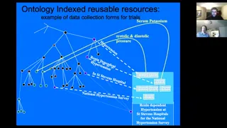
        6:10 Ontology-indexed data collection forms for trials
      </a>
    </li>
    <li>
      <a class="home-thumb" href="interviews/alan-rector-part-3/#t=720" data-start="720">
        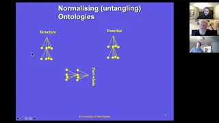
        12:00 Normalising (untangling) ontologies
      </a>
    </li>
    <li>
      <a class="home-thumb" href="interviews/alan-rector-part-3/#t=900" data-start="900">
        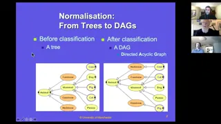
        15:00 Normalisation: from trees to DAGs
      </a>
    </li>
  </ul>
</section>
<section class="home-film" id="home-film-4">
  <h4 class="home-film-title"><a href="interviews/alan-rector-part-4/">4. Lessons learned – how we’d do it today + some advice to those entering the health informatics space</a> <a class="home-film-more" href="interviews/alan-rector-part-4/">[Click for other video formats, full transcript, links etc.]</a></h4>
  

    

      <video id="home-film-player-4" controls preload="metadata" playsinline>
        <source src="https://archive.org/download/pen-pad-interview-alan-rector-part4/pen-pad-interview-alan-rector-part4_1080p.mp4" type="video/mp4">
        <track kind="subtitles" srclang="en" label="English" src="/assets/interviews/part-4/pen-pad-interview-alan-rector-part4.en.vtt" default>
      </video>
    

    

      <ol>
        <li><a class="home-chapter" href="interviews/alan-rector-part-4/#t=0" data-start="0">0:00 How would you do this today? Where do SNOMED CT, openEHR archetypes, HL7 FHIR and queries fit in? (The &#x27;propeller&#x27; paper)</a></li>
        <li><a class="home-chapter" href="interviews/alan-rector-part-4/#t=48" data-start="48">0:48 Terminology is just one part of the system: concept model, information/EHR model and inference model - coordinated, but not the same thing</a></li>
        <li><a class="home-chapter" href="interviews/alan-rector-part-4/#t=259" data-start="259">4:19 If doing it today: archetypes hung on a concept model? Grading and staging of cancers in a cancer trial project</a></li>
        <li><a class="home-chapter" href="interviews/alan-rector-part-4/#t=454" data-start="454">7:34 openEHR, FHIR and finding the right granularity - &#x27;I&#x27;d certainly use SNOMED if I were starting today&#x27;</a></li>
        <li><a class="home-chapter" href="interviews/alan-rector-part-4/#t=517" data-start="517">8:37 Query SNOMED rather than create new concepts. Lessons from the ICD-11 project: statistics need stability, and ICD wouldn&#x27;t work for PEN&amp;PAD</a></li>
        <li><a class="home-chapter" href="interviews/alan-rector-part-4/#t=860" data-start="860">14:20 Building on SNOMED: watch out for primitives with more than one parent, and terminologies built by committee</a></li>
        <li><a class="home-chapter" href="interviews/alan-rector-part-4/#t=1082" data-start="1082">18:02 Redoing PEN&amp;PAD today: rethink user centered design for touch screens, pens, voice and natural language - &#x27;Is this what you meant?&#x27;</a></li>
        <li><a class="home-chapter" href="interviews/alan-rector-part-4/#t=1371" data-start="1371">22:51 Don&#x27;t make one thing serve too many purposes (HL7 V3 prescriptions) - a flexible combination of modules</a></li>
        <li><a class="home-chapter" href="interviews/alan-rector-part-4/#t=1587" data-start="1587">26:27 Centering the record on the patient, and language generation for clinicians and for patients</a></li>
        <li><a class="home-chapter" href="interviews/alan-rector-part-4/#t=1784" data-start="1784">29:44 Sharing records between institutions and departments - find the nugget that needs to be transmitted; how do you summarize?</a></li>
        <li><a class="home-chapter" href="interviews/alan-rector-part-4/#t=2119" data-start="2119">35:19 Systems built out of bits and pieces - lessons from SGML and HTML (&#x27;Page not found&#x27;)</a></li>
        <li><a class="home-chapter" href="interviews/alan-rector-part-4/#t=2398" data-start="2398">39:58 Advice to students coming into health informatics from the computer or the medical side - talk to psychologists, nurses and junior doctors</a></li>
        <li><a class="home-chapter" href="interviews/alan-rector-part-4/#t=2884" data-start="2884">48:04 Alan&#x27;s acknowledgements: the PEN&amp;PAD, GALEN and OWL teams</a></li>
        <li><a class="home-chapter" href="interviews/alan-rector-part-4/#t=2990" data-start="2990">49:50 The end</a></li>
      </ol>
    

  

  <ul class="home-film-thumbs">
    <li>
      <a class="home-thumb" href="interviews/alan-rector-part-4/#t=270" data-start="270">
        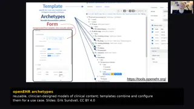
        4:30 openEHR archetypes
      </a>
    </li>
    <li>
      <a class="home-thumb" href="interviews/alan-rector-part-4/#t=360" data-start="360">
        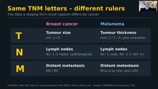
        6:00 Same TNM letters — different rulers
      </a>
    </li>
    <li>
      <a class="home-thumb" href="interviews/alan-rector-part-4/#t=415" data-start="415">
        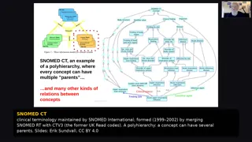
        6:55 SNOMED CT as a polyhierarchy
      </a>
    </li>
  </ul>
</section>

## Papers and links
* [Foundations for an Electronic Medical Record](https://opengalen.eggbird.eu/download/FoundationsofEMR.pdf) A. Rector, WA Nolan, S Kay. Methods of Information in Medicine 30: 179-86, 1991. [PDF](https://opengalen.eggbird.eu/download/FoundationsofEMR.pdf)
* [A patient care workstation based on user centred design and a formal theory of medical terminology: PEN&PAD and the SMK formalism](https://pmc.ncbi.nlm.nih.gov/articles/PMC2247651/) W A Nowlan, A L Rector, S Kay, B Horan, A Wilson. Proc Annu Symp Comput Appl Med Care. 1991;855-7. [PDF](https://web.archive.org/web/20250204073942/https://pmc.ncbi.nlm.nih.gov/articles/PMC2247651/pdf/procascamc00004-0865.pdf) [Google Scholar](https://scholar.google.com/scholar?q=%22A%20patient%20care%20workstation%20based%20on%20user%20centred%20design%20and%20a%20formal%20theory%20of%20medical%20terminology%3A%20PEN%26PAD%20and%20the%20SMK%20formalism%22)
* [User Centred Development of a General Practice Medical Workstation: The PEN&PAD Experience](https://opengalen.eggbird.eu/download/PENandPAD.pdf) AL Rector, B Horan, M Fittert, S Kay, PD Newton, WA Nowlan, D Robinson, and A Wilson. 1992. [PDF](https://opengalen.eggbird.eu/download/PENandPAD.pdf)
* [A Terminology Server for Medical Language and Medical Information Systems](https://opengalen.eggbird.eu/download/imia-94.pdf) Rector, A., Solomon, W., Nowlan, W., Rush, T, Claassen, A.W.M. and Zanstra, P.E. Methods of Information in Medicine, Vol 34, 147-157. 1994. [PDF](https://opengalen.eggbird.eu/download/imia-94.pdf)
* [The GALEN CORE Model Schemata for Anatomy: Towards a Re-usable Application-Independent Model of Medical Concepts](https://opengalen.eggbird.eu/download/mie-94.pdf) AL Rector, A Gangemi, E Galeazzi, AJ Glowinski, A Rossi-Mori. Twelfth International Congress of the European Federation for Medical Informatics, MIE-94, Lisbon, Portugal, 229-233. 1994. [PDF](https://opengalen.eggbird.eu/download/mie-94.pdf)
* [Coordinating Taxonomies: Key To Re-usable Concept Representations](https://opengalen.eggbird.eu/download/aime-95.pdf) AL Rector. Fifth conference on Artificial Intelligence in Medicine Europe (AIME '95), Pavia, Italy, Springer 17-28. 1995. [PDF](https://opengalen.eggbird.eu/download/aime-95.pdf)
* [Medical-concept models and medical records: an approach based on GALEN and PEN&PAD](https://pmc.ncbi.nlm.nih.gov/articles/PMC116234/) A L Rector, A J Glowinski, W A Nowlan, A Rossi-Mori. J Am Med Inform Assoc. 1995 Jan-Feb;2(1):19-35. [PDF](https://web.archive.org/web/20250204213602/https://pmc.ncbi.nlm.nih.gov/articles/PMC116234/pdf/0020019.pdf) [Google Scholar](https://scholar.google.com/scholar?q=%22Medical-concept%20models%20and%20medical%20records%3A%20an%20approach%20based%20on%20GALEN%20and%20PEN%26PAD%22)
* [The PEN&PAD data entry system: from prototype to practical system](https://pubmed.ncbi.nlm.nih.gov/8947757/) J Kirby, A L Rector. Proc AMIA Annu Fall Symp. 1996;709-13. [PDF](https://web.archive.org/web/20250407141355/https://pmc.ncbi.nlm.nih.gov/articles/PMC2232997/pdf/procamiaafs00002-0744.pdf) [Google Scholar](https://scholar.google.com/scholar?q=%22The%20PEN%26PAD%20data%20entry%20system%3A%20from%20prototype%20to%20practical%20system%22)
* [Rubrics to Dissections to GRAIL to Classifications](https://opengalen.eggbird.eu/download/mie97vum.pdf) JE Rogers, WD Solomon, AL Rector, P Pole, P Zanstra, E van der Haring. Fifteenth International Congress of the European Federation for Medical Informatics, MIE-97 Thessaloniki, Greece: 241-245. 1997. [PDF](https://opengalen.eggbird.eu/download/mie97vum.pdf)
* [Terminological Systems: Bridging the Generation Gap](https://opengalen.eggbird.eu/download/scamc97.pdf) JE Rogers, AL Rector. Annual Fall Symposium of American Medical Informatics Association Nashville TN, Hanley & Belfus Inc Philadelphia PA: 610-614. 1997. [PDF](https://opengalen.eggbird.eu/download/scamc97.pdf)
* [Reconciling users' needs and formal requirements: issues in developing a reusable ontology for medicine](https://pubmed.ncbi.nlm.nih.gov/10719533/) A L Rector, P E Zanstra, W D Solomon, J E Rogers, R Baud, W Ceusters, W Claassen, J Kirby, J-M Rodrigues, A Rossi Mori, E J van der Haring, J Wagner. IEEE Trans Inf Technol Biomed. 1998 Dec;2(4):229-42. [PDF](https://opengalen.eggbird.eu/download/Reconciling-users-needs.pdf) [Google Scholar](https://scholar.google.com/scholar?q=%22Reconciling%20users%27%20needs%20and%20formal%20requirements%3A%20issues%20in%20developing%20a%20reusable%20ontology%20for%20medicine%22)
* [GALEN's Model of Parts and Wholes: Experience and Comparisons](https://opengalen.eggbird.eu/download/PartsAndWholes.pdf) Rogers JE, Rector, AL. Annual Fall Symposium of American Medical Informatics Association, Los Angeles CA Hanley & Belfus Inc Philadelphia PA;:714-8. 2000. [PDF](https://opengalen.eggbird.eu/download/PartsAndWholes.pdf)
* [Having our cake and eating it too: how the GALEN Intermediate Representation reconciles internal complexity with users' requirements for appropriateness and simplicity](https://pmc.ncbi.nlm.nih.gov/articles/PMC2244105/) W D Solomon, A Roberts, J E Rogers, C J Wroe, A L Rector. Proc AMIA Symp. 2000;819-23. [PDF](https://web.archive.org/web/20241227174409/https://pmc.ncbi.nlm.nih.gov/articles/PMC2244105/pdf/procamiasymp00003-0854.pdf) [Google Scholar](https://scholar.google.com/scholar?q=%22Having%20our%20cake%20and%20eating%20it%20too%3A%20how%20the%20GALEN%20Intermediate%20Representation%20reconciles%20internal%20complexity%20with%20users%27%20requirements%20for%20appropriateness%20and%20simplicity%22)
* [GALEN Ten Years On: Tasks and Supporting tools](https://opengalen.eggbird.eu/download/GALENTenYearsOn.pdf) Rogers JE, Roberts A, Solomon WD, van der Haring E, Wroe CJ, Zanstra PE, Rector, AL. Proc MEDINFO2001 (London), Vimla Patel et al (Eds) IOS Press;: 256-260. 2001. [PDF](https://opengalen.eggbird.eu/download/GALENTenYearsOn.pdf)
* [OpenGALEN: open source medical terminology and tools](https://pmc.ncbi.nlm.nih.gov/articles/PMC1480228/) A L Rector, J E Rogers, P E Zanstra, E Van Der Haring. AMIA Annu Symp Proc. 2003;982. [PDF](https://web.archive.org/web/20241226190934/https://pmc.ncbi.nlm.nih.gov/articles/PMC1480228/pdf/amia2003_0982.pdf) [Google Scholar](https://scholar.google.com/scholar?q=%22OpenGALEN%3A%20open%20source%20medical%20terminology%20and%20tools%22) A short summary of how OpenGALEN was formed in 1999 to share the results of the GALEN research programme (begun in 1991) as open source, including its ontology development environment and large description logic-based medical ontology.
* [Granularity Scale & Collectivity: When size does and doesn't matter](https://opengalen.eggbird.eu/download/scale-and-granularity-body-rector-pub-final.pdf) Rector AL, Rogers JE, Bittner T. Journal of Biomedical Informatics. 2005. [PDF](https://opengalen.eggbird.eu/download/scale-and-granularity-body-rector-pub-final.pdf) [Annex: Tables](https://opengalen.eggbird.eu/download/scale-and-granularity-tables-rector-pub-final.pdf)
* [Quality Assurance of Medical Ontologies](https://opengalen.eggbird.eu/download/Rogers-Quality-Assurance-of-Medical-Ontologies.pdf) JE Rogers. Methods Inf Med 2006 45(3):267-274. [PDF](https://opengalen.eggbird.eu/download/Rogers-Quality-Assurance-of-Medical-Ontologies.pdf)
* [On beyond Gruber: “Ontologies” in today’s biomedical information systems and the limits of OWL.](https://www.sciencedirect.com/science/article/pii/S2590177X19300010) Alan Rector, Stefan Schulz, Jean Marie Rodrigues, Christopher G. Chute, and Harold Solbrig. Journal of Biomedical Informatics: X 2 (2019): 100002. [Google Scholar](https://scholar.google.com/scholar?q=%22On%20beyond%20Gruber%3A%20%22Ontologies%22%20in%20today%27s%20biomedical%20information%20systems%20and%20the%20limits%20of%20OWL%22)

Technical reports and notes, also from the [OpenGALEN publications page](https://opengalen.eggbird.eu/sources/publications.html):

* [Structured Methods of Information Management for Medical Records](https://opengalen.eggbird.eu/download/WANowlanThesis.pdf) WA Nowlan. Doctoral Thesis (Manchester). 1993. [PDF](https://opengalen.eggbird.eu/download/WANowlanThesis.pdf) [A5 PDF recovered by the author, 2026](assets/WA-Nowlan-thesis-1993-A5.pdf)
* [HUMPTY, a natural language generator for OpenGALEN: Theory and implementation](https://opengalen.eggbird.eu/download/AWM%20Claassen-Humpty-Theory%20and%20Background.pdf) AWM Claassen. Internal report, NICI, Radboud University Nijmegen. 1998. [PDF](https://opengalen.eggbird.eu/download/AWM%20Claassen-Humpty-Theory%20and%20Background.pdf)
* [Development of a methodology and an ontological schema for medical terminology](https://opengalen.eggbird.eu/download/2004-Rogers-Methodology-and-ontological-schema-for-medical-terminology-%28MD-Thesis%29.pdf) JE Rogers. MD Doctoral Thesis (Manchester). 2004. [PDF](https://opengalen.eggbird.eu/download/2004-Rogers-Methodology-and-ontological-schema-for-medical-terminology-%28MD-Thesis%29.pdf)
* [Ontological & Practical Issues in using a Description Logic to Represent Medical Concepts: Experience from GALEN](https://opengalen.eggbird.eu/download/cspp35.pdf) AL Rector, JE Rogers. School of Computer Science PrePrint, University of Manchester: CSPP-35:1-35. 2006. [PDF](https://opengalen.eggbird.eu/download/cspp35.pdf)
* [Explanatory notes on the OpenGALEN OWL Translations](https://opengalen.eggbird.eu/download/OpenGALEN_OWL_Translations_Documentation.pdf) JE Rogers, WD Solomon, AL Rector, Y Kazakov, I Horrocks. 2010. [PDF](https://opengalen.eggbird.eu/download/OpenGALEN_OWL_Translations_Documentation.pdf)

* The OpenGALEN website contains a lot of background information, downloadable ontology, tools and links to more informaton. Two known copies are:
  * [https://opengalen.eggbird.eu/](https://opengalen.eggbird.eu/)
  * [opengalen.org frozen copy via archive.org](https://web.archive.org/web/20220308122743/https://opengalen.org/)
* A longer list of GALEN and OpenGALEN scientific papers and technical reports, many with PDFs, is on the [OpenGALEN publications page](https://opengalen.eggbird.eu/sources/publications.html).
* An [OpenGALEN 8 browser](opengalen-browser/) for the published hierarchy is on this site ([source on GitHub](https://github.com/erik-sundvalls-bots/opengalen-browser), including the [GALEN sources](https://github.com/erik-sundvalls-bots/opengalen-browser/tree/main/sources)). To suggest an improvement or a feature, see [Suggest improvement/feature](https://github.com/erik-sundvalls-bots/opengalen-browser/issues) or [open one](https://github.com/erik-sundvalls-bots/opengalen-browser/issues/new).

## Clinergy
Clinergy was a structured data entry system for primary care built on the PEN&PAD approach, "built on top of a live GALEN terminology server delivering an adaptation of a GALEN Common Reference Model" ([OpenGALEN software page](https://opengalen.eggbird.eu/sources/software.html)). Alan Rector demonstrates it in [interview part 1](interviews/alan-rector-part-1/#t=685), and the [thumb pain walkthrough](docs/clinergy-thumb-pain-demo/) goes through that demo screen by screen.

* **Demo download:** [ClinergyDemo.zip](https://opengalen.eggbird.eu/download/ClinergyDemo.zip) (6 MB, a 1998 Windows installer) from the OpenGALEN mirror. There is also a [copy archived from opengalen.org](https://web.archive.org/web/20070818150258/http://www.opengalen.org/download/clinergydemo.zip). The demo is © 1997-8 Semantic Technologies Ltd / Victoria University of Manchester, All Rights Reserved.
* **Extractor:** [clinergy-extractor](https://github.com/erik-sundvalls-bots/clinergy-extractor) turns your copy of the zip into human-readable YAML: one file per data-entry form, plus concepts, examinations, summary-sentence rules and body maps. It also exports body-map pictures, icons, cursors and bitmaps (BMP/ICO/CUR converted to PNG; ICO/CUR originals kept; WMF kept as `.wmf`) to `images/` with an `images.yaml` index, and records body-map hotspot coordinates in `bodymap.yaml`. How to run the extractor, and how to run the demo under Wine on Linux, is on the [Clinergy extractor and Wine notes](docs/clinergy/) page. The output is a private study copy. Please don't publish it.

## Snomed CT Expo 2021 talk
* At [SNOMED CT Expo 2021](https://www.snomed.org/news-and-events/events/snomedct-expo) Daniel Karlsson and Erik Sundvall presented the PEN & PAD inspired talk "Context-aware interactive use of SNOMED CT and terminology services in openEHR-based electronic health records"
    * Slides: [https://docs.google.com/presentation/d/1BQxf-2NGhoFjlYEdRCdNoBWtUAS1qpn0/edit?usp=sharing&ouid=112660550613841635682&rtpof=true&sd=true](https://docs.google.com/presentation/d/1BQxf-2NGhoFjlYEdRCdNoBWtUAS1qpn0/edit?usp=sharing&ouid=112660550613841635682&rtpof=true&sd=true) 
    * Video recording is available at [https://youtu.be/G0NI-xF2AXM](https://youtu.be/G0NI-xF2AXM) and the [SNOMED CT Expo website](https://www.snomed.org/news-and-events/events/snomedct-expo)
    * Thanks to [Better](https://www.better.care/) for providing free trial access to [EHR Studio](https://playground.better.care/studio/) Low/No-code openEHR tool.
    * Thanks to [Håkan Örman](https://liu.se/en/employee/hakpe59) for providing remote login to a working Clinergy demo installation at Linköping University (It is still used in teaching!)

## Help wanted
* Experd/nerd-competence needed for exploring and documenting how the old Windows XP based Clinergy demo can be installed and run in emulators on Linux, Mac OS and Windows 10+
* Website editing
* Creation of pedagogical material from interviews and PEN&PAD-related papers (focused video snippets, transcriptions, summaries, tutorials etc.) in order to inspire a new generation of developers, clinicians and informaticians to revive the PEN & PAD approach using the tools available today.

## Challenge
This can be suitable as student projects, hackathon challenges, personal learning projects etc. 
* Use low/no-code tools and user centered design to recreate appraches from PEN&PAD... 
* ...then fork this repository, and create a subdirectory of your own under the `challenge` subdirectory https://github.com/pen-pad-revival/pen-pad-revival.github.io/tree/main/challenge with a readme.md file including a description (and links to your project site if available) including ways to contact you.
* Add other relevant description-related files (like screenshots) in your subdirectory.
* Then edit the readme file in the `challenge` directory to include a describing title with a link to your subdirectory
* Finally submit a pull request so that we can include your addition here.

Ask a local GIT-nerd for help if the process above sounds too complicated.

